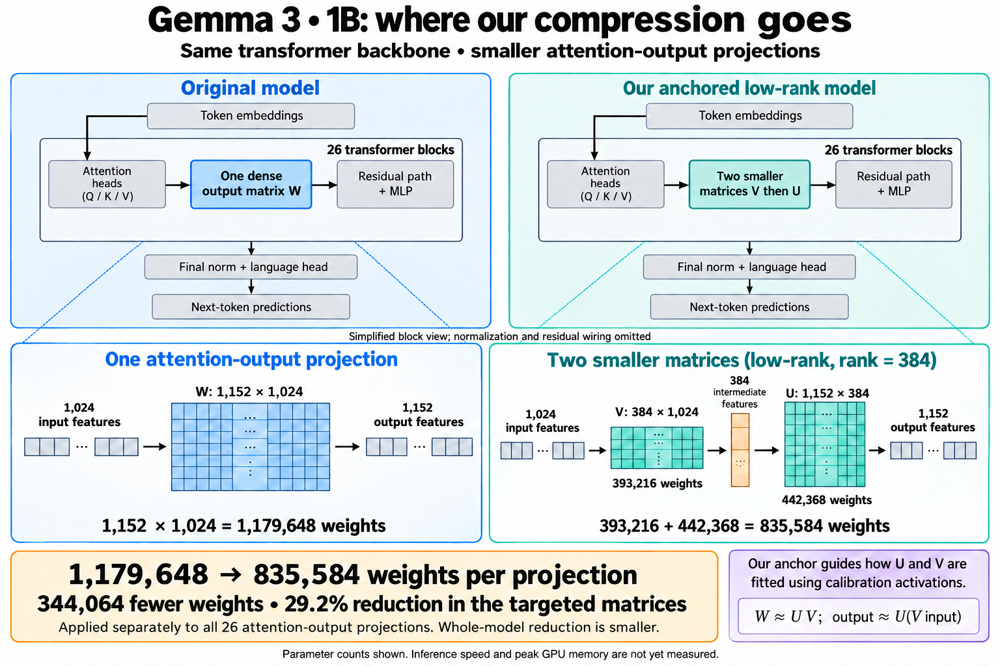

# ResearchCompression

**Authorized bounded work is complete: five BF16 practical conditions, two
seeds (11 and 23).** No research GPU worker remains; follow-up automation is paused.
The old FP16/INT8 run remains stopped. See the
[BF16 amendment](docs/BF16_TWO_SEED_20261014.md). All historical results remain preserved.


Can a pretrained transformer's dense weights be replaced by a more compact
representation **without breaking the global computation**?

An empirical study of activation-aware low-rank compression, anchoring and
cross-layer drift. **Current state: Bounded experiments and review artifacts complete, 14 October 2026.**

The user resumed work after review. See the [continuation decision](docs/CONTINUATION_20261014.md)
and the [active execution ledger](results/paper-v2/revised-orchestration-20261014-5-bf16/status.json).

## Start here

- [Readable paper PDF](docs/paper-ieee-preparation-20261015/manuscript.pdf),
  [plain-language abstract](docs/paper-ieee-preparation-20261015/abstract.md), and
  [provisional IEEE conference source](docs/paper-ieee-preparation-20261015/ieee-conference.tex).
  The [publication research](docs/paper-ieee-preparation-20261015/IEEE_PUBLICATION_RESEARCH.md)
  records verified IEEE guidance and the still-unidentified submission venue/deadline.
- [Single-author, two-column paper PDF](docs/paper-reference-style-20261015/manuscript.pdf)
  and [LaTeX](docs/paper-reference-style-20261015/manuscript.tex): seven-page edition
  matching the supplied reference's A4/Times layout, with the verified current evidence.
- [Revised paper PDF](docs/paper-revision-20261015/manuscript.pdf),
  [Markdown](docs/paper-revision-20261015/manuscript.md) and
  [LaTeX](docs/paper-revision-20261015/manuscript.tex): 15 October editorial revision
  with compact evidence tables and explicit numerical/coverage limitations.
  See the [revision notes](docs/paper-revision-20261015/README.md).
- [Remaining paper tasks](TASKS.md): experiment, manuscript and release checklist.
- [Review handoff](docs/REVIEW_20261014.md): completed work and known limits.
- [Final bounded-study evidence report](results/paper-v2/revised-report-20261014-151432-07c08d61/report.md).
- [Review manuscript PDF](results/paper-v2/revised-report-20261014-151432-07c08d61/manuscript.pdf)
  and [Markdown/figures](results/paper-v2/revised-report-20261014-151432-07c08d61/manuscript.md).
  Qwen remains budget-limited; all gaps are explicit in this final bounded-study report.
- [Documentation index](docs/README.md): protocol, audits, testing and historical drafts.

## What is compressed

In each of Gemma's 26 transformer blocks, the attention-output projection mixes
the attention heads' 1,024 output features into the 1,152-dimensional hidden
representation. We replace that projection with two rank-384 factors:

```text
Original:  1,024 features -> W [1,152 x 1,024] -> 1,152 features
Low-rank:  1,024 features -> V [384 x 1,024] -> 384 features
                         -> U [1,152 x 384] -> 1,152 features

Dense:     1,152 x 1,024                 = 1,179,648 weights
Factors:   384 x 1,024 + 1,152 x 384      =   835,584 weights
Reduction: 344,064 weights per projection, or 29.2% of the target weights
```

The low-rank representation creates the reduction. Anchoring guides the fitting
of the factors; whitening uses the same factor budget. Whole-model savings are
smaller: the separate BF16 practical cohort saves 0.894% of serialized whole-model
bytes. Its latency comparisons are workload-dependent; no consistent acceleration
or global-preservation advantage is established.



## Completed Gemma quality reference (historical FP16 cohort)

Native WikiText-2 test, context/stride 512/256, all attention-output projections,
rank 384, FP16 factors. Lower perplexity is better.

| Method | Test perplexity |
|---|---:|
| Dense teacher | 31.55 |
| Plain SVD | 162.18 |
| Fixed-rank ASVD component | 40.22 |
| Whitening component | 35.62 |
| Anchor, beta 0.03 and no extra ridge | 35.37 |
| Legacy extra-ridge variant | 35.84 |

Calibration-dependent results are means across seeds 11/23/37; SVD and teacher
are evaluated once. Anchoring slightly improves full-stack NLL versus whitening,
but does not consistently improve residual drift. The middle four-layer group
worsens both NLL and drift across all three seeds. All evidence remains
exploratory; no practical or universal advantage is established.

Completed: Gemma regularization/baselines, 60 composition records with reuse
identified, and seven numerical BF16/FP8 controls. The new architecture assets are
pinned Qwen3.5-0.8B and LFM2.5-1.2B. Qwen's eight primary test records are saved;
its bounded run closed with 10/18 validation records and an explicit budget gap.
LFM completed all 26 declared records. The revised panel contains three models,
including Gemma; GPT-2 is excluded from future execution.

See the [current amendment](docs/EXPERIMENT_PLAN_20261014_AMENDMENT.md) for exact
revisions, hybrid attention-only scope, validation rank frontier and unchanged
budget limits. Reliable preservation of global computation remains unresolved.

Qwen's frozen primary comparison is now saved for all three seeds: mean native
test perplexity is **18.811 for whitening and 18.979 for anchor**. Anchor also has
higher residual drift in every seed. This weakens the anchor hypothesis for
these six full-attention outputs at rank 483. Its full validation frontier remains
incomplete. The separate five-condition BF16 practical cohort is complete. These PPL values must
not be used to rank Qwen against Gemma because their tokenizers differ.

## Repository map

| Path | Contents |
|---|---|
| [TASKS.md](TASKS.md) | Remaining work and completion criteria |
| [docs/](docs/README.md) | Current documentation, figures, audits and historical material |
| [configs/](configs/README.md) | Pinned current and preserved experiment configurations |
| [src/](src/README.md) | Current paper modules and preserved earlier experiments |
| `tests/` | Protocol, mathematics, runner and reporting verification |
| [results/](results/README.md) | Immutable measurements, run contracts and reports |
| `paper-assets/` | Local preparation manifests and cached dataset; model snapshots live in the HF cache |
| [docs/archive/](docs/archive/README.md) | Historical drafts, former README and earlier Word paper |
| [THREAD.md](THREAD.md), `research-loop/` | Earlier research history and orchestration |

The dated audit/recovery utilities remain at their recorded paths so existing
contracts, hashes and references remain usable. Research JSON/provenance stays
eligible for Git; large checkpoints, caches and environments remain ignored.

## Verification and execution

Use the working CUDA environment for the CPU unit suite:

```powershell
rtk .venv-cuda/Scripts/python.exe -m pytest tests/unit -q
```

See [TESTING.md](docs/TESTING.md) for verification and the
[finalization guide](docs/REVISED_STUDY_FINALIZATION_20261014.md) for reports and
plots. The reporting interpreter on this PC is separate from the CUDA environment.

The authorized continuation runs sequentially with fresh output directories,
verified provenance and cumulative cost accounting. Existing review snapshots
remain preserved; consult the active ledger for current process/stage state.
Do not blindly rerun a historical dispatcher or overwrite an earlier run.

The [former README](docs/archive/README-before-20261014-cleanup.md) and historical
papers are preserved. Their subset-evaluation numbers, denoising interpretations
and lossless-INT8 claims are not current matched-study conclusions.
