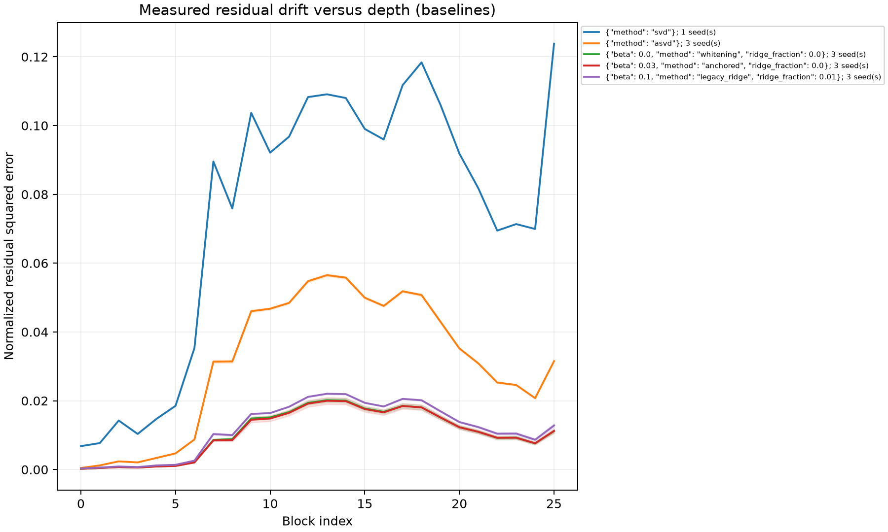

# Protocol-v2 manuscript working template

> Historical interim template, retained for its related-work and bibliography
> source sections. Its stage-status tables predate the model amendment and reboot
> recoveries; GPT-2 is excluded from the active study. Follow [TASKS.md](../TASKS.md)
> and the [documentation index](README.md) for current evidence and generated
> manuscripts. This file is not the final paper or a live execution ledger.

Version: 2026-10-14. Status: **Stages B/C completed; composition continuing; all compression evidence exploratory**.
This additive manuscript skeleton preserves previous drafts and historical evidence.
The authoritative protocol and bibliography requirements are in [EXPERIMENT_PLAN.md](EXPERIMENT_PLAN.md).

## Working question and abstract

When does activation-weighted low-rank compression preserve a transformer's
global behavior, and what benefit remains against activation-aware baselines?
The planned study separates weighting, anchoring, and ridge shrinkage, compares
matched fixed-rank components, profiles composition drift, and replicates frozen
settings on GPT-2. Completed Gemma comparisons show a small anchoring NLL
improvement over whitening, with inconsistent seedwise drift improvement.
**Strict FP16 readiness failed; no compression advantage is established.**

## Mathematical methods

Let W map input activations X to teacher outputs WX. Canonical weighting minimizes
|| (W - UV)X ||_F^2. Anchoring adds beta n || W - UV ||_F^2, giving the metric
H = XX^T + beta n I. With an invertible metric the rank-r approximation is formed
by truncating W H^(1/2) and multiplying by H^(-1/2). In the singular unanchored
case the declared pseudoinverse convention and nullspace behavior must accompany
the result. Full-rank anchored recovery gives W; an additional ridge penalty on
the solution changes this optimum and must be described as shrinkage. Exact
numerical constants and implementation equations will be transcribed from the
resolved run configurations after the mathematical audit.

Fixed-rank ASVD and whitening-only SVD-LLM are component comparisons. They do
not reproduce adaptive rank allocation or recovery fine-tuning pipelines.

## Historical exploratory evidence

Previous WikiText subset/disjoint-window results belong here, with original
commands, splits, numerical settings, and uncertainty limitations. Do not copy
historical PPL values into protocol-v2 comparison tables or infer cross-protocol
improvements. Their provenance remains in existing drafts and result artifacts.

## Protocol-v2 evidence tables

### Numerical readiness diagnosis (reported measurements)

The dense teacher's native-test NLL is 3.451562542535798 on 292,281 shifted
targets. These controls isolate factorization numerics; they do not measure
low-rank compression advantage. Measurements below are from completed run
`svd-diagnosis-20261013-165146-c3671715`, retained in
[metrics.json](../results/paper-v2/svd-diagnosis-20261013-165146-c3671715/metrics.json)
and [status.json](../results/paper-v2/svd-diagnosis-20261013-165146-c3671715/status.json).

| Control | Maximum absolute probe logit difference | Native-test NLL | Probe gate | NLL gate |
|---|---:|---:|---|---|
| Dense FP32 SVD reconstruction | 0.1171875 | 3.4516607005255278 | Passed | Passed |
| Dense FP16 SVD reconstruction | 0.140625 | 3.45170480830851 | Failed | Passed |
| Unbalanced full-rank FP16 SVD factors | 0.15234375 | 3.4518601608007997 | Failed | Passed |
| Balanced full-rank FP16 SVD factors | 0.181640625 | 3.451848345084197 | Failed | Passed |
| Full-rank FP32 factorized execution | 0.1171875 | 3.451771295262287 | Passed | Passed |

The observed full-rank FP16 discrepancy is a numerical floor rather than
evidence that rank truncation preserves global behavior. The strict readiness
gate remains in force: comparison runs with readiness_passed=false or missing
readiness evidence remain exploratory. The dense reconstruction control passes
the combined absolute/relative tolerance; its maximum absolute value alone is
not a replacement tolerance. Source run artifacts must accompany final tables.

| Study component | Required evidence | Current manuscript status |
|---|---|---|
| Identity/readiness | teacher immutability, dtype tolerance, full-test targets | Diagnosis completed; FP16 SVD probe gate failed, FP32 execution passed |
| Regularization controls | validation sweeps, frozen selected settings, shrinkage control | Completed; anchor beta 0.03 selected on validation |
| Main baseline comparison | each of seeds 11/23/37; NLL/PPL, KL, drift, sizes | Completed; exploratory because FP16 readiness failed |
| Composition | 1/2/4/all projection groups, downstream drift | Continuation running; prior 34 completed records preserved |
| GPT-2 replication | transferred settings, three seeds | Pending |
| Calibration | validation temperature, frozen evaluation, 15 bins | Pending |
| Packed costs | FP16/INT8 reload, bytes, warm latency, memory | Pending |
| Fresh confirmation | pinned sampled C4; frozen settings | Not part of first 24 GPU-hour study; pending authorization/assets |

### Validation selection (Stage B)

Completed run [regularization-20261013-171941-804f4c2e](../results/paper-v2/regularization-20261013-171941-804f4c2e/metrics.json)
scores 257,289 validation targets using calibration seed 11. Exact anchoring
beta 0.03/ridge zero minimizes the declared validation criterion (NLL
3.596622391, PPL 36.47482843), versus whitening beta zero (NLL 3.600788986,
PPL 36.62712134). Both selected anchor and selected solver are this same
candidate; they are not independent methods. The frozen strongest baseline
is whitening. The full-rank ridge control PPL 33.090111 is unmatched in factor
budget and cannot establish compressed quality. ASVD validation PPL is
41.933066; plain SVD is 171.547601. The
[frozen selection](../results/paper-v2/regularization-20261013-171941-804f4c2e/selection.json)
records exact model/data revisions, calibration hashes/positions, and split hashes.

### Matched full-stack native-test comparisons (Stage C)

Completed run [baselines-20261013-175255-6a00d4e8](../results/paper-v2/baselines-20261013-175255-6a00d4e8/metrics.json)
evaluates every one of 292,281 native-test targets with context 512/stride 256.
All 26 Gemma attention output projections (1152×1024) use rank 384, 835,584
FP16 factor parameters per projection. Every factor archive is 43,465,927
bytes including archive overhead; this is not whole-model serialized storage.
The dense teacher PPL is 31.54965149. Test results did not select hyperparameters.

| Method | Seed | Test NLL | Test PPL | Primary drift |
|---|---:|---:|---:|---:|
| SVD | deterministic | 5.088681121 | 162.17583073 | 0.074247583 |
| ASVD component | 11 | 3.697111535 | 40.33064232 | 0.031182043 |
| ASVD component | 23 | 3.693921384 | 40.20218645 | 0.030942521 |
| ASVD component | 37 | 3.692365249 | 40.13967510 | 0.030790672 |
| Whitening component | 11 | 3.562754086 | 35.26017308 | 0.010324710 |
| Whitening component | 23 | 3.569856607 | 35.51150069 | 0.010524397 |
| Whitening component | 37 | 3.585830798 | 36.08332322 | 0.011063442 |
| Exact anchor beta 0.03 | 11 | 3.559634834 | 35.15035908 | 0.010327733 |
| Exact anchor beta 0.03 | 23 | 3.561186442 | 35.20494098 | 0.010202436 |
| Exact anchor beta 0.03 | 37 | 3.576942101 | 35.76401075 | 0.011110835 |
| Legacy beta 0.1/ridge 0.01 | 11 | 3.570095829 | 35.51999683 | 0.011683665 |
| Legacy beta 0.1/ridge 0.01 | 23 | 3.579942337 | 35.87147234 | 0.011869712 |
| Legacy beta 0.1/ridge 0.01 | 37 | 3.587064641 | 36.12787187 | 0.011954536 |

| Method | NLL mean ± sample SD | PPL mean ± sample SD | Teacher KL mean ± sample SD | Drift mean ± sample SD |
|---|---:|---:|---:|---:|
| ASVD | 3.694466 ± 0.002420 | 40.224168 ± 0.097363 | 0.374854 ± 0.003696 | 0.030972 ± 0.000197 |
| Whitening | 3.572814 ± 0.011819 | 35.618332 ± 0.421846 | 0.138217 ± 0.006976 | 0.010638 ± 0.000382 |
| Exact anchor | 3.565921 ± 0.009576 | 35.373104 ± 0.339634 | 0.136755 ± 0.006822 | 0.010547 ± 0.000492 |
| Recorded legacy ridge | 3.579034 ± 0.008521 | 35.839780 ± 0.305174 | 0.157781 ± 0.006031 | 0.011836 ± 0.000139 |

SVD is calibration-independent and is recorded once, with KL 1.558671537;
no three-seed standard deviation is inferred for it. The legacy comparison
is an FP64 algebraic reproduction using measured teacher outputs minus bias,
not a bitwise rerun of the old FP32 implementation.

Anchoring lowers NLL versus whitening in every seed, but primary drift improves
only in seed 23 and regresses slightly in seeds 11 and 37. The candidate thus
does not satisfy reproducible drift improvement. Every compressed method
regresses PPL against the dense teacher. No practical success or promotion
follows from these exploratory results; paired block uncertainty and measured
hardware costs remain necessary.

An [interim CPU report](../results/paper-v2/interim-analysis-d2080d7f/report.json)
gives anchored-minus-whitening full-test NLL differences and paired-block
intervals: seed 11 −0.00311925 [−0.00559843, −0.000577106], seed 23
−0.00867017 [−0.0123616, −0.00487939], and seed 37 −0.00888870
[−0.0115643, −0.00619303]. These use 2,000 paired resamples of 71 complete
4,096-target blocks; 1,465 tail targets are excluded from intervals but included
in full-test NLL. They quantify block variation, not calibration-seed variation,
and do not override readiness, drift, or hardware gates.

The [figure provenance](figures/20261014-032234-41dc5749/provenance.json)
records hashes of completed source metrics and contract. Curves use actual
per-block measurements; shading is not a confidence interval. Whole-model
storage/quality figures remain pending practical measurements.

### Incomplete composition snapshot

`composition-20261013-185512-2bffd477` was interrupted after 34 complete records;
all artifacts are retained. Windows events 41/6008 confirm an unexpected reboot.
The charge of 8,972.373 seconds is estimated from the last log plus 60 seconds,
not a proven upper bound on pre-reboot elapsed time; this accounting uncertainty
is explicitly retained in the continuation's `accounting-caveat.json`.
`composition-20261014-032120-486d799f` is running with 5,427.627 seconds remaining
under the same four-hour cap. Complete records may be reused with explicit
provenance; proven identical full-stack C reuse is not independent replication.
No complete composition conclusion is drawn from this interim snapshot.

## Statistical reporting and decisions

Report every seed and sample standard deviation across seeds. Use 2,000 paired
bootstrap resamples of contiguous 4,096-target blocks for NLL differences; do
not resample dependent individual targets. Pair methods on the same ordered
target positions and reject differing split manifests. The final partial block
is included in full-test NLL but excluded from fixed-size block resampling;
report the excluded target count and the bootstrap-subset point estimate.
Block intervals quantify evaluation variation, not calibration-seed variation.

Promote only with a matched global improvement, improved predeclared normalized
residual squared drift, all three seeds, no storage regression, and no more than
5% median-latency or peak-memory regression against the matched factorized
baseline. If differences remain within uncertainty, state **no established
advantage**. Missing drift, costs, contracts, or seeds leave evidence exploratory.

## Reproducibility and incomplete runs

For every included run link the unique output directory, resolved configuration,
exact command, source hash/revision, package/device versions, asset revisions,
split hashes, calibration positions, factors/checkpoint hashes, terminal status,
and incremental metrics. Include failed, incomplete, and cancelled comparisons
alongside completed runs. Time caps are not grounds for reducing evaluation or
seed counts. Claims about matrix storage and whole-model savings remain separate.

## Related work and scope of the planned evidence

Data-aware low-rank compression predates this study. [DRONE](https://proceedings.neurips.cc/paper/2021/hash/f56de5ef149cf0aedcc8f4797031e229-Abstract.html)
derives a closed-form approximation informed by layer representations in BERT
[@chen2021drone]. [Fisher-weighted factorization](https://arxiv.org/abs/2207.00112)
uses parameter importance to address disagreement between matrix reconstruction
and task accuracy [@hsu2022weighted]. These are context for the present question:
low local weight error alone cannot establish preserved global computation.

[ASVD](https://arxiv.org/abs/2312.05821) adapts decomposition to activation
distributions and layer sensitivity [@yuan2023asvd].
[SVD-LLM](https://arxiv.org/abs/2403.07378) combines truncation-aware whitening
with sequential updates after compression [@wang2024svdllm]. Our fixed-rank
diagonal ASVD and whitening-only SVD-LLM isolate their weighting components
under a matched factor budget. They are not full-pipeline reproductions.
[SVD-LLM V2](https://aclanthology.org/2025.naacl-long.217/) changes rank allocation
and singular-value truncation [@wang2025svdllmv2], so it belongs in a later
adaptive-budget study rather than a claim that fixed per-matrix ranks reproduce
its complete procedure.

Global composition is already an explicit target of related work.
[SAES-SVD](https://arxiv.org/abs/2602.03051) addresses accumulated and local
errors [@hu2026saessvd]; [LACE-SVD](https://arxiv.org/abs/2607.03057) combines
loss-aware allocation with residual-stream correction [@liu2026lacesvd].
Our smaller-group and downstream-drift comparisons test the location and extent
of composition damage, without claiming to resolve it. The next comparator is
SAES-SVD if cumulative drift remains the decisive failure.
[Quantization Error Propagation](https://arxiv.org/abs/2504.09629) demonstrates
why accumulated errors also matter in layer-wise quantization [@arai2025qep].
That connection motivates measuring downstream behavior, but does not equate
low-rank truncation with quantization or transfer an existing method's results.

Loss-aware global allocation provides further distinctions from this study's
fixed-rank setup. [Zero Sum SVD](https://arxiv.org/abs/2602.02848) uses whitened
component sensitivities under a global pruning rule [@abbasi2026zerosum].
[IO-SVD](https://arxiv.org/abs/2605.15626) adds an output-side predictive metric
and heterogeneous rank selection [@abbasi2026iosvd]. These motivate future
equal-total-budget comparisons. They do not establish novelty for an anchored
input-covariance truncation or for the current extra-ridge solver.

The practical comparison distinguishes storage, accuracy, and execution cost.
[GPTQ](https://arxiv.org/abs/2210.17323) uses approximate second-order information
for post-training quantization [@frantar2022gptq].
[AWQ](https://arxiv.org/abs/2306.00978) uses activation-informed channel protection
and an inference implementation [@lin2023awq].
[SparseGPT](https://arxiv.org/abs/2301.00774) studies one-shot pruning
[@frantar2023sparsegpt]. These are different representations, not matched
fixed-rank baselines in the first wave. Their practical emphasis motivates
recording actual checkpoint bytes and warmed end-to-end timings.

[EoRA](https://arxiv.org/abs/2410.21271) compensates compressed models with
eigenspace-informed low-rank branches [@liu2024eora].
[SVDQuant](https://arxiv.org/abs/2411.05007) absorbs outliers in a high-precision
low-rank branch while quantizing a residual branch, and identifies the runtime
overhead of naive separate branch execution [@li2024svdquant]. SVDQuant's
published scope is diffusion models. It supplies a system-design warning for
future hybrid experiments here, not evidence of LLM quality or speedups.

[CKA](https://proceedings.mlr.press/v97/kornblith19a.html) measures alignment
between representation similarities [@kornblith2019cka]. We use it as a
secondary diagnostic beside the predeclared normalized residual squared error;
neither representation similarity nor norm preservation substitutes for held-out
NLL or logit KL. [Temperature scaling](https://proceedings.mlr.press/v70/guo17a.html)
is a validation-fitted calibration control [@guo2017calibration], adapted here
to next-token probabilities. Improvement after temperature fitting would not
by itself identify an LLM denoising mechanism.

Evaluation conventions can change apparent model rankings; the reproducibility
guidance in [Biderman et al.](https://arxiv.org/abs/2405.14782) motivates pinned
assets, task formats and declared target masking [@biderman2024evaluation].
[Pointer Sentinel Mixture Models](https://arxiv.org/abs/1609.07843) introduced
WikiText [@merity2016wikitext]. Because WikiText has already informed this
project, its present test evaluation is regression evidence. The later fresh
confirmation samples a locked C4 shard, whose provenance is the
[T5 study](https://jmlr.org/papers/v21/20-074.html) [@raffel2020t5]. Neither its
sampled confirmation nor the initial WikiText wave represents all text domains.
[HellaSwag](https://aclanthology.org/P19-1472/) supplies a commonsense completion
benchmark [@zellers2019hellaswag], and [ARC](https://arxiv.org/abs/1803.05457)
supplies science-question reasoning with an explicit Challenge subset
[@clark2018arc]. Those downstream evaluations remain pending; no downstream
accuracy claim follows from the readiness controls.

## Verified bibliography and dates

The additive [BibTeX file](paper_protocol_v2.bib) contains the 22 plan references,
verified from primary metadata on 2026-10-13. Preprint entries use the first
submission year, record the checked revision, and separately note a venue when
the primary page identifies one. In particular SVD-LLM is a 2024 preprint with
ICLR 2025 metadata, GPTQ is a 2022 preprint with ICLR 2023 metadata, AWQ is a
2023 preprint with MLSys 2024 metadata, and SVDQuant is a 2024 preprint with ICLR
2025 metadata. EoRA's current primary metadata identifies **ICLR 2026 workshops**,
not main-conference publication. T5 is cited as its 2020 JMLR article, with its
2019 preprint date recorded separately. Unverified venues are omitted.

Author lists reflect the verified source version. The ASVD v5 author list and
the EoRA v6 list differ from some earlier bibliographies; this file does not
silently mix versions. Hsu et al.'s author spelling follows the conference PDF
(Sung-En Chang); the arXiv metadata spells that name Sungen Chang. The direct
OpenReview page returned a browser challenge, so metadata was cross-checked
with the primary paper's indexed PDF and its arXiv record.

## Conclusion

**No established compression advantage.** Stage C finds lower mean NLL for
anchoring than whitening, but primary drift improvement is inconsistent across
seeds and strict FP16 readiness is false. Composition, cross-architecture, and
practical conclusions remain pending. These bounded exploratory observations
do not establish a general solution to preserving global computation.
