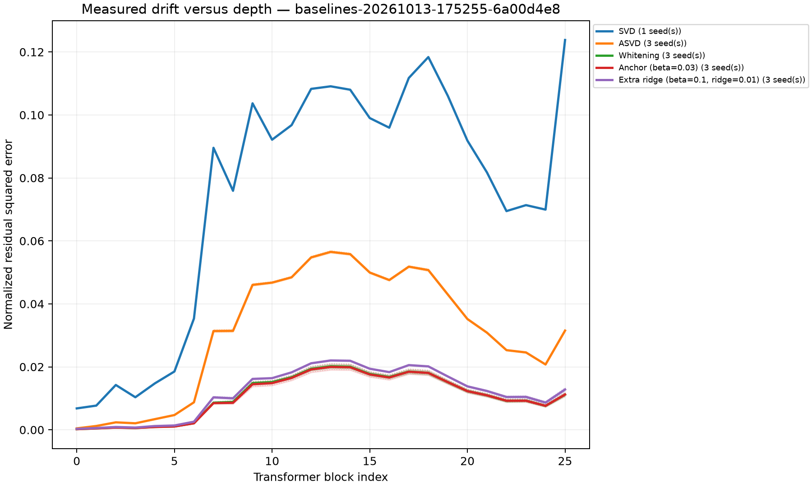
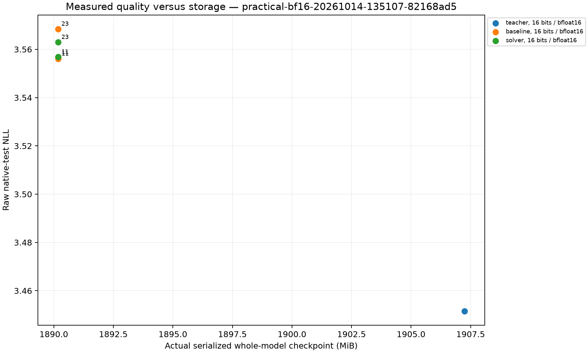

# Activation-Weighted Low-Rank Compression: Likelihood, Drift, and Practical Cost

Version: 2026-10-14T15:10:57.729314+00:00

## Abstract

This report examines whether matched activation-weighted low-rank approximations preserve global transformer behavior. It retains weighting/anchoring controls, full-stack and composition measurements, separate BF16/FP8 numerical controls, and the user-amended hybrid-architecture panel. Tables below are generated from retained artifacts; failed/incomplete attempts remain visible. Targeted weight-count reduction is separated from likelihood, representation drift and measured execution costs. The evidence does not establish reliable global preservation or a consistent anchoring advantage over matched whitening. Promotion remains disabled; a terminal dispatcher does not imply every scientific cohort completed.

## Study status and scope

Dispatcher: **completed with incomplete cohorts**. Report mode: terminal orchestration report.

The amended panel uses Gemma, Qwen3.5-0.8B and LFM2.5-1.2B-Instruct; GPT-2 is excluded. Only full-attention output projections are targeted in the hybrids. Native-tokenizer PPL is compared within each model. Validation frontier ranks and primary test ranks remain separate; no selection is made using confirmation outcomes.

### Later BF16-only practical amendment

After stopping the historical FP16/INT8 practical stage, the user authorized only BF16 model testing with at most two seeds. The new practical cohort has five declared conditions: a BF16 dense teacher, and BF16 whitening/anchor models for seeds 11 and 23. Native BF16 measured-output factor preparation retains the frozen objective and rank. Historical other-format and three-seed evidence is preserved, not relabeled or pooled with this cohort. Higher-precision fitting/metric accumulation is numerical computation, not another model-format test. Two seeds cannot satisfy the original three-seed promotion gate. The stopped stage remains charged against the original shared practical cap.

### Declared numerical-control omissions

The continuation formally omits unfinished dense_fp8_e4m3 and dense_fp8_e5m2 controls. All seven saved controls, including failed gates, and the cancelled attempt remain preserved. This scope closure does not claim that the original nine-control cohort completed or that native FP8 model inference was tested.

## Mathematical methods and frozen constants

Let $W\in\mathbb{R}^{o\times i}$ and $X\in\mathbb{R}^{i\times n}$. Write $A=UV$ with rank at most $r$. The anchored objective is $\|(W-A)X\|_F^2+\beta n\|W-A\|_F^2$.

The replacement is the attention-output projection after head outputs are combined; attention heads themselves are not pruned. Fitting is offline, and inference applies V followed by U in place of W. Anchoring adds no runtime branch or extra factor parameters: it changes only the fitting geometry.

For each Gemma target, the dense matrix has 1152 x 1024 = 1,179,648 weights. Rank 384 stores 1152 x 384 + 384 x 1024 = 835,584 weights: 344,064 fewer, or 29.17% of that projection. Across 26 targets the reduction is 8,945,664 weights. These are targeted weight counts, not a 29.17% whole-model reduction; embeddings, MLPs and other untargeted weights remain.

Set $H=XX^T+\beta nI$ and $C=WH$ for exact teacher outputs. For measured outputs subtract the teacher bias first: $Y_b=Y-b\mathbf{1}^T$, then $C=Y_bX^T+\beta nW$. The extra-ridge solver adds $\lambda I$ to the geometry, with $\lambda=\rho\,\operatorname{mean}(\operatorname{eig}(H))$. For $G=H+\lambda I$, form $A_\mathrm{full}=CG^\dagger$ and truncate $A_\mathrm{full}G^{1/2}$ to rank $r$; multiply back by $G^{\dagger/2}$. Thus ridge-free full-rank anchored recovery gives $W$ on retained spectral directions, while positive extra ridge generally shrinks it.

The implementation computes weighted covariance, eigendecomposition and weighted truncation in FP64, then returns FP32 factors for the declared storage cast. It clamps negative numerical eigenvalues to zero and retains regularized eigenvalues strictly above $\mathrm{rcond}\,\lambda_\max(G)$. Plain SVD uses FP32. Fixed-rank diagonal ASVD uses $s_j=\max(\operatorname{mean}_t|X_{jt}|,10^{-8})^{0.5}$, truncates $W\operatorname{diag}(s)$, and scales back. Factors use the recorded unbalanced convention unless a run contract explicitly declares a separate convention.

The predeclared validation anchor sweep is beta={0,0.03,0.1,0.3,1}; the extra-ridge fractions are rho={0,0.001,0.01} at beta=0.1. Validation NLL ties within 1e-6 prefer less regularization. Native evaluation uses context/stride 512/256, full shifted targets including the tail, and 16 disjoint 512-token calibration chunks for seeds 11/23/37. The primary Gemma attention-output rank is 384. The amended hybrid rank is floor((17/24)*out*in/(out+in)); frontier ranks are floor(min(out,in)/divisor) for validation-only divisors2/3/4. Exact observed run constants and factor precisions follow below; missing fields remain unrecorded.

| Run | Precision | Main rank | Pseudoinverse rcond | Config beta | Config ridge fraction | Selected solver / baseline |
|---|---|---:|---:|---:|---:|---|
| architecture-replication-20261014-082807-5c73f669 | bfloat16 | shape-derived by 17/24 factor/dense fraction | 1e-07 | unmeasured | unmeasured | {"baseline": {"beta": 0.0, "method": "whitening", "ridge_fraction": 0.0}, "solver": {"beta": 0.03, "method": "anchored", "ridge_fraction": 0.0}} |
| architecture-replication-20261014-093845-97378b5e | bfloat16 | shape-derived by 17/24 factor/dense fraction | 1e-07 | unmeasured | unmeasured | {"baseline": {"beta": 0.0, "method": "whitening", "ridge_fraction": 0.0}, "solver": {"beta": 0.03, "method": "anchored", "ridge_fraction": 0.0}} |
| architecture-replication-20261014-103759-8d32ab84 | bfloat16 | shape-derived by 17/24 factor/dense fraction | 1e-07 | unmeasured | unmeasured | {"baseline": {"beta": 0.0, "method": "whitening", "ridge_fraction": 0.0}, "solver": {"beta": 0.03, "method": "anchored", "ridge_fraction": 0.0}} |
| baselines-20261013-175255-6a00d4e8 | float16 | 384 | 1e-07 | 0.1 | 0.01 | {"baseline": "SVD and fixed-rank ASVD / whitening-only components, same FP16/rank", "solver": null} |
| composition-20261013-185512-2bffd477 | float16 | 384 | 1e-07 | 0.1 | 0.01 | {"baseline": {"beta": 0.0, "method": "whitening", "ridge_fraction": 0.0}, "solver": null} |
| composition-20261014-032120-486d799f | float16 | 384 | 1e-07 | 0.1 | 0.01 | {"baseline": {"beta": 0.0, "method": "whitening", "ridge_fraction": 0.0}, "solver": null} |
| composition-20261014-054423-dbd821ff | float16 | 384 | 1e-07 | 0.1 | 0.01 | {"baseline": {"beta": 0.0, "method": "whitening", "ridge_fraction": 0.0}, "solver": null} |
| practical-20261014-113642-0fe078b5 | float16 | 384 | 1e-07 | 0.1 | 0.01 | {"baseline": {"beta": 0.0, "method": "whitening", "ridge_fraction": 0.0}, "solver": null} |
| practical-bf16-20261014-135107-82168ad5 | bfloat16 | 384 | 1e-07 | 0.03 | 0 | {"baseline": {"beta": 0.0, "method": "whitening", "ridge_fraction": 0.0}, "solver": {"beta": 0.03, "method": "anchored", "ridge_fraction": 0.0}} |
| precision-readiness-20261014-060840-6db37daf | float16 | 384 | 1e-07 | 0.1 | 0.01 | {"baseline": "untouched dense BF16 teacher and copied BF16 control", "solver": null} |
| regularization-20261013-171941-804f4c2e | float16 | 384 | 1e-07 | 0.1 | 0.01 | {"baseline": "SVD and fixed-rank ASVD / whitening-only components, same FP16/rank", "solver": null} |
## Related work and scope of the planned evidence

Data-aware low-rank compression predates this study. [DRONE](https://proceedings.neurips.cc/paper/2021/hash/f56de5ef149cf0aedcc8f4797031e229-Abstract.html)
derives a closed-form approximation informed by layer representations in BERT
[@chen2021drone]. [Fisher-weighted factorization](https://arxiv.org/abs/2207.00112)
uses parameter importance to address disagreement between matrix reconstruction
and task accuracy [@hsu2022weighted]. These are context for the present question:
low local weight error alone cannot establish preserved global computation.

[ASVD](https://arxiv.org/abs/2312.05821) adapts decomposition to activation
distributions and layer sensitivity [@yuan2023asvd].
[SVD-LLM](https://arxiv.org/abs/2403.07378) combines truncation-aware whitening
with sequential updates after compression [@wang2024svdllm]. Our fixed-rank
diagonal ASVD and whitening-only SVD-LLM isolate their weighting components
under a matched factor budget. They are not full-pipeline reproductions.
[SVD-LLM V2](https://aclanthology.org/2025.naacl-long.217/) changes rank allocation
and singular-value truncation [@wang2025svdllmv2], so it belongs in a later
adaptive-budget study rather than a claim that fixed per-matrix ranks reproduce
its complete procedure.

Global composition is already an explicit target of related work.
[SAES-SVD](https://arxiv.org/abs/2602.03051) addresses accumulated and local
errors [@hu2026saessvd]; [LACE-SVD](https://arxiv.org/abs/2607.03057) combines
loss-aware allocation with residual-stream correction [@liu2026lacesvd].
Our smaller-group and downstream-drift comparisons test the location and extent
of composition damage, without claiming to resolve it. The next comparator is
SAES-SVD if cumulative drift remains the decisive failure.
[Quantization Error Propagation](https://arxiv.org/abs/2504.09629) demonstrates
why accumulated errors also matter in layer-wise quantization [@arai2025qep].
That connection motivates measuring downstream behavior, but does not equate
low-rank truncation with quantization or transfer an existing method's results.

Loss-aware global allocation provides further distinctions from this study's
fixed-rank setup. [Zero Sum SVD](https://arxiv.org/abs/2602.02848) uses whitened
component sensitivities under a global pruning rule [@abbasi2026zerosum].
[IO-SVD](https://arxiv.org/abs/2605.15626) adds an output-side predictive metric
and heterogeneous rank selection [@abbasi2026iosvd]. These motivate future
equal-total-budget comparisons. They do not establish novelty for an anchored
input-covariance truncation or for the current extra-ridge solver.

The practical comparison distinguishes storage, accuracy, and execution cost.
[GPTQ](https://arxiv.org/abs/2210.17323) uses approximate second-order information
for post-training quantization [@frantar2022gptq].
[AWQ](https://arxiv.org/abs/2306.00978) uses activation-informed channel protection
and an inference implementation [@lin2023awq].
[SparseGPT](https://arxiv.org/abs/2301.00774) studies one-shot pruning
[@frantar2023sparsegpt]. These are different representations, not matched
fixed-rank baselines in the first wave. Their practical emphasis motivates
recording actual checkpoint bytes and warmed end-to-end timings.

[EoRA](https://arxiv.org/abs/2410.21271) compensates compressed models with
eigenspace-informed low-rank branches [@liu2024eora].
[SVDQuant](https://arxiv.org/abs/2411.05007) absorbs outliers in a high-precision
low-rank branch while quantizing a residual branch, and identifies the runtime
overhead of naive separate branch execution [@li2024svdquant]. SVDQuant's
published scope is diffusion models. It supplies a system-design warning for
future hybrid experiments here, not evidence of LLM quality or speedups.

[CKA](https://proceedings.mlr.press/v97/kornblith19a.html) measures alignment
between representation similarities [@kornblith2019cka]. We use it as a
secondary diagnostic beside the predeclared normalized residual squared error;
neither representation similarity nor norm preservation substitutes for held-out
NLL or logit KL. [Temperature scaling](https://proceedings.mlr.press/v70/guo17a.html)
is a validation-fitted calibration control [@guo2017calibration], adapted here
to next-token probabilities. Improvement after temperature fitting would not
by itself identify an LLM denoising mechanism.

Evaluation conventions can change apparent model rankings; the reproducibility
guidance in [Biderman et al.](https://arxiv.org/abs/2405.14782) motivates pinned
assets, task formats and declared target masking [@biderman2024evaluation].
[Pointer Sentinel Mixture Models](https://arxiv.org/abs/1609.07843) introduced
WikiText [@merity2016wikitext]. Because WikiText has already informed this
project, its present test evaluation is regression evidence. The later fresh
confirmation samples a locked C4 shard, whose provenance is the
[T5 study](https://jmlr.org/papers/v21/20-074.html) [@raffel2020t5]. Neither its
sampled confirmation nor the initial WikiText wave represents all text domains.
[HellaSwag](https://aclanthology.org/P19-1472/) supplies a commonsense completion
benchmark [@zellers2019hellaswag], and [ARC](https://arxiv.org/abs/1803.05457)
supplies science-question reasoning with an explicit Challenge subset
[@clark2018arc]. Those downstream evaluations remain pending; no downstream
accuracy claim follows from the readiness controls.

## Recorded numerical controls

FP16 SVD readiness remains failed. Later BF16/FP8 variants are separate numerical cohorts, not repaired FP16 evidence. FP8 codes are decoded before BF16 multiplication; native tiny-GEMM support does not establish native model speed.

| Run / state | Variant | NLL | PPL | Maximum probe error | Probe gate | NLL gate |
|---|---|---:|---:|---:|---|---|
| precision-readiness-20261014-060840-6db37daf / cancelled | teacher_bf16 | 3.4515495 | 31.5492399 | 0 | True | True |
| precision-readiness-20261014-060840-6db37daf / cancelled | copy_bf16 | 3.4515495 | 31.5492399 | 0 | True | True |
| precision-readiness-20261014-060840-6db37daf / cancelled | identity_bf16 | 3.4515495 | 31.5492399 | 0 | True | True |
| precision-readiness-20261014-060840-6db37daf / cancelled | svd_bf16 | 3.45265812 | 31.5842357 | 1.0625 | False | False |
| precision-readiness-20261014-060840-6db37daf / cancelled | svd_fp32_compute | 3.45158372 | 31.5503197 | 1.15625 | False | True |
| precision-readiness-20261014-060840-6db37daf / cancelled | svd_fp8_e4m3 | 3.45542964 | 31.6718934 | 9.73046875 | False | False |
| precision-readiness-20261014-060840-6db37daf / cancelled | svd_fp8_e5m2 | 3.47055948 | 32.1547273 | 7.8671875 | False | False |
| readiness-20261013-164122-cdc919e9 / failed | teacher | 3.45156254 | 31.5496515 | 0 | True | unrecorded |
| readiness-20261013-164122-cdc919e9 / failed | copied_teacher | 3.45156254 | 31.5496515 | 0 | True | unrecorded |
| readiness-20261013-164407-bda5b4d9 / completed | teacher | 3.45156254 | 31.5496515 | 0 | True | unrecorded |
| readiness-20261013-164407-bda5b4d9 / completed | copied_teacher | 3.45156254 | 31.5496515 | 0 | True | unrecorded |
| readiness-20261013-164407-bda5b4d9 / completed | full_rank_factorized | 3.45156254 | 31.5496515 | 0 | True | unrecorded |
| svd-diagnosis-20261013-165146-c3671715 / completed | teacher | 3.45156254 | 31.5496515 | unmeasured | unrecorded | unrecorded |
| svd-diagnosis-20261013-165146-c3671715 / completed | dense_svd_fp32 | 3.4516607 | 31.5527485 | 0.1171875 | True | True |
| svd-diagnosis-20261013-165146-c3671715 / completed | dense_svd_fp16 | 3.45170481 | 31.5541402 | 0.140625 | False | True |
| svd-diagnosis-20261013-165146-c3671715 / completed | unbalanced_fp16 | 3.45186016 | 31.5590426 | 0.15234375 | False | True |
| svd-diagnosis-20261013-165146-c3671715 / completed | balanced_fp16 | 3.45184835 | 31.5586697 | 0.181640625 | False | True |
| svd-diagnosis-20261013-165146-c3671715 / completed | float32_execution | 3.4517713 | 31.5562382 | 0.1171875 | True | True |

## Validation regularization controls

Every row identifies its attempt and scope. Mean ± sample standard deviation is across available calibration seeds; a single seed has no estimated seed standard deviation. Incomplete attempts and partial seed coverage do not constitute a full cohort.

| Run / state | Specification | Split / group / rank scope | Seeds | NLL mean | NLL seed SD | Drift mean | Drift seed SD |
|---|---|---|---|---:|---:|---:|---:|
| regularization-20261013-171941-804f4c2e / completed | {"method": "svd"} | {} | [11] | 5.14486078 | unmeasured | unmeasured | unmeasured |
| regularization-20261013-171941-804f4c2e / completed | {"beta": 0.1, "method": "fullrank_ridge", "ridge_fraction": 0.01} | {} | [11] | 3.49923448 | unmeasured | unmeasured | unmeasured |
| regularization-20261013-171941-804f4c2e / completed | {"beta": 0.0, "method": "whitening", "ridge_fraction": 0.0} | {} | [11] | 3.60078899 | unmeasured | unmeasured | unmeasured |
| regularization-20261013-171941-804f4c2e / completed | {"beta": 0.03, "method": "anchored", "ridge_fraction": 0.0} | {} | [11] | 3.59662239 | unmeasured | unmeasured | unmeasured |
| regularization-20261013-171941-804f4c2e / completed | {"beta": 0.1, "method": "anchored", "ridge_fraction": 0.0} | {} | [11] | 3.59675176 | unmeasured | unmeasured | unmeasured |
| regularization-20261013-171941-804f4c2e / completed | {"beta": 0.3, "method": "anchored", "ridge_fraction": 0.0} | {} | [11] | 3.607465 | unmeasured | unmeasured | unmeasured |
| regularization-20261013-171941-804f4c2e / completed | {"beta": 1.0, "method": "anchored", "ridge_fraction": 0.0} | {} | [11] | 3.61579886 | unmeasured | unmeasured | unmeasured |
| regularization-20261013-171941-804f4c2e / completed | {"beta": 0.1, "method": "legacy_ridge", "ridge_fraction": 0.0} | {} | [11] | 3.59685438 | unmeasured | unmeasured | unmeasured |
| regularization-20261013-171941-804f4c2e / completed | {"beta": 0.1, "method": "legacy_ridge", "ridge_fraction": 0.001} | {} | [11] | 3.59727845 | unmeasured | unmeasured | unmeasured |
| regularization-20261013-171941-804f4c2e / completed | {"beta": 0.1, "method": "legacy_ridge", "ridge_fraction": 0.01} | {} | [11] | 3.60682971 | unmeasured | unmeasured | unmeasured |
| regularization-20261013-171941-804f4c2e / completed | {"method": "asvd"} | {} | [11] | 3.73607467 | unmeasured | unmeasured | unmeasured |

## Gemma full-stack component comparisons

Every row identifies its attempt and scope. Mean ± sample standard deviation is across available calibration seeds; a single seed has no estimated seed standard deviation. Incomplete attempts and partial seed coverage do not constitute a full cohort.

| Run / state | Specification | Split / group / rank scope | Seeds | NLL mean | NLL seed SD | Drift mean | Drift seed SD |
|---|---|---|---|---:|---:|---:|---:|
| baselines-20261013-175255-6a00d4e8 / completed | {"method": "svd"} | {} | [11] | 5.08868112 | unmeasured | 0.0742475831 | unmeasured |
| baselines-20261013-175255-6a00d4e8 / completed | {"method": "asvd"} | {} | [11, 23, 37] | 3.69446606 | 0.00241956806 | 0.0309717453 | 0.00019731531 |
| baselines-20261013-175255-6a00d4e8 / completed | {"beta": 0.0, "method": "whitening", "ridge_fraction": 0.0} | {} | [11, 23, 37] | 3.57281383 | 0.0118191598 | 0.0106375166 | 0.000382136395 |
| baselines-20261013-175255-6a00d4e8 / completed | {"beta": 0.03, "method": "anchored", "ridge_fraction": 0.0} | {} | [11, 23, 37] | 3.56592113 | 0.00957592299 | 0.0105470011 | 0.000492296849 |
| baselines-20261013-175255-6a00d4e8 / completed | {"beta": 0.1, "method": "legacy_ridge", "ridge_fraction": 0.01} | {} | [11, 23, 37] | 3.57903427 | 0.00852077408 | 0.0118359709 | 0.000138552104 |

## Composition and group heterogeneity

Every row identifies its attempt and scope. Mean ± sample standard deviation is across available calibration seeds; a single seed has no estimated seed standard deviation. Incomplete attempts and partial seed coverage do not constitute a full cohort.

| Run / state | Specification | Split / group / rank scope | Seeds | NLL mean | NLL seed SD | Drift mean | Drift seed SD |
|---|---|---|---|---:|---:|---:|---:|
| composition-20261013-185512-2bffd477 / interrupted | {"beta": 0.0, "method": "whitening", "ridge_fraction": 0.0} | {"group": [0], "rank": 384, "split": "test"} | [11, 23, 37] | 3.45206785 | 0.000410778252 | 0.00207792164 | 0.00017472334 |
| composition-20261013-185512-2bffd477 / interrupted | {"beta": 0.03, "method": "anchored", "ridge_fraction": 0.0} | {"group": [0], "rank": 384, "split": "test"} | [11, 23, 37] | 3.45201942 | 0.000409256997 | 0.00207452887 | 0.000178507413 |
| composition-20261013-185512-2bffd477 / interrupted | {"beta": 0.0, "method": "whitening", "ridge_fraction": 0.0} | {"group": [12], "rank": 384, "split": "test"} | [11, 23, 37] | 3.45825421 | 0.00132397251 | 8.76745161e-05 | 2.4463997e-06 |
| composition-20261013-185512-2bffd477 / interrupted | {"beta": 0.03, "method": "anchored", "ridge_fraction": 0.0} | {"group": [12], "rank": 384, "split": "test"} | [11, 23, 37] | 3.4579111 | 0.00143757277 | 8.91802058e-05 | 2.24916162e-06 |
| composition-20261013-185512-2bffd477 / interrupted | {"beta": 0.0, "method": "whitening", "ridge_fraction": 0.0} | {"group": [25], "rank": 384, "split": "test"} | [11, 23, 37] | 3.45142891 | 0.000329325004 | 1.69831209e-06 | 9.05406025e-08 |
| composition-20261013-185512-2bffd477 / interrupted | {"beta": 0.03, "method": "anchored", "ridge_fraction": 0.0} | {"group": [25], "rank": 384, "split": "test"} | [11, 23, 37] | 3.45122641 | 0.000131137763 | 2.023157e-06 | 9.42299447e-08 |
| composition-20261013-185512-2bffd477 / interrupted | {"beta": 0.0, "method": "whitening", "ridge_fraction": 0.0} | {"group": [0, 1], "rank": 384, "split": "test"} | [11, 23, 37] | 3.45442908 | 0.00205462111 | 0.00365644585 | 0.000137627131 |
| composition-20261013-185512-2bffd477 / interrupted | {"beta": 0.03, "method": "anchored", "ridge_fraction": 0.0} | {"group": [0, 1], "rank": 384, "split": "test"} | [11, 23, 37] | 3.45438131 | 0.00214728679 | 0.00356760921 | 0.000238304358 |
| composition-20261013-185512-2bffd477 / interrupted | {"beta": 0.0, "method": "whitening", "ridge_fraction": 0.0} | {"group": [12, 13], "rank": 384, "split": "test"} | [11, 23, 37] | 3.46353003 | 0.00115146509 | 0.000141608504 | 4.06719991e-06 |
| composition-20261013-185512-2bffd477 / interrupted | {"beta": 0.03, "method": "anchored", "ridge_fraction": 0.0} | {"group": [12, 13], "rank": 384, "split": "test"} | [11, 23, 37] | 3.46353582 | 0.00129669463 | 0.000144554107 | 4.09979657e-06 |
| composition-20261013-185512-2bffd477 / interrupted | {"beta": 0.0, "method": "whitening", "ridge_fraction": 0.0} | {"group": [24, 25], "rank": 384, "split": "test"} | [11, 23, 37] | 3.45212529 | 0.000451146203 | 1.23266207e-05 | 3.68456941e-07 |
| composition-20261013-185512-2bffd477 / interrupted | {"beta": 0.03, "method": "anchored", "ridge_fraction": 0.0} | {"group": [24, 25], "rank": 384, "split": "test"} | [11] | 3.45195513 | unmeasured | 1.21042136e-05 | unmeasured |
| composition-20261014-032120-486d799f / interrupted | {"beta": 0.0, "method": "whitening", "ridge_fraction": 0.0} | {"group": [0], "rank": 384, "split": "test"} | [11, 23, 37] | 3.45206785 | 0.000410778252 | 0.00207792164 | 0.00017472334 |
| composition-20261014-032120-486d799f / interrupted | {"beta": 0.03, "method": "anchored", "ridge_fraction": 0.0} | {"group": [0], "rank": 384, "split": "test"} | [11, 23, 37] | 3.45201942 | 0.000409256997 | 0.00207452887 | 0.000178507413 |
| composition-20261014-032120-486d799f / interrupted | {"beta": 0.0, "method": "whitening", "ridge_fraction": 0.0} | {"group": [12], "rank": 384, "split": "test"} | [11, 23, 37] | 3.45825421 | 0.00132397251 | 8.76745161e-05 | 2.4463997e-06 |
| composition-20261014-032120-486d799f / interrupted | {"beta": 0.03, "method": "anchored", "ridge_fraction": 0.0} | {"group": [12], "rank": 384, "split": "test"} | [11, 23, 37] | 3.4579111 | 0.00143757277 | 8.91802058e-05 | 2.24916162e-06 |
| composition-20261014-032120-486d799f / interrupted | {"beta": 0.0, "method": "whitening", "ridge_fraction": 0.0} | {"group": [25], "rank": 384, "split": "test"} | [11, 23, 37] | 3.45142891 | 0.000329325004 | 1.69831209e-06 | 9.05406025e-08 |
| composition-20261014-032120-486d799f / interrupted | {"beta": 0.03, "method": "anchored", "ridge_fraction": 0.0} | {"group": [25], "rank": 384, "split": "test"} | [11, 23, 37] | 3.45122641 | 0.000131137763 | 2.023157e-06 | 9.42299447e-08 |
| composition-20261014-032120-486d799f / interrupted | {"beta": 0.0, "method": "whitening", "ridge_fraction": 0.0} | {"group": [0, 1], "rank": 384, "split": "test"} | [11, 23, 37] | 3.45442908 | 0.00205462111 | 0.00365644585 | 0.000137627131 |
| composition-20261014-032120-486d799f / interrupted | {"beta": 0.03, "method": "anchored", "ridge_fraction": 0.0} | {"group": [0, 1], "rank": 384, "split": "test"} | [11, 23, 37] | 3.45438131 | 0.00214728679 | 0.00356760921 | 0.000238304358 |
| composition-20261014-032120-486d799f / interrupted | {"beta": 0.0, "method": "whitening", "ridge_fraction": 0.0} | {"group": [12, 13], "rank": 384, "split": "test"} | [11, 23, 37] | 3.46353003 | 0.00115146509 | 0.000141608504 | 4.06719991e-06 |
| composition-20261014-032120-486d799f / interrupted | {"beta": 0.03, "method": "anchored", "ridge_fraction": 0.0} | {"group": [12, 13], "rank": 384, "split": "test"} | [11, 23, 37] | 3.46353582 | 0.00129669463 | 0.000144554107 | 4.09979657e-06 |
| composition-20261014-032120-486d799f / interrupted | {"beta": 0.0, "method": "whitening", "ridge_fraction": 0.0} | {"group": [24, 25], "rank": 384, "split": "test"} | [11, 23, 37] | 3.45212529 | 0.000451146203 | 1.23266207e-05 | 3.68456941e-07 |
| composition-20261014-032120-486d799f / interrupted | {"beta": 0.03, "method": "anchored", "ridge_fraction": 0.0} | {"group": [24, 25], "rank": 384, "split": "test"} | [11, 23, 37] | 3.45194198 | 0.000101102007 | 1.22970593e-05 | 3.91576035e-07 |
| composition-20261014-032120-486d799f / interrupted | {"beta": 0.0, "method": "whitening", "ridge_fraction": 0.0} | {"group": [0, 1, 2, 3], "rank": 384, "split": "test"} | [11, 23, 37] | 3.46224947 | 0.000734496385 | 0.0061389891 | 0.000142663396 |
| composition-20261014-032120-486d799f / interrupted | {"beta": 0.03, "method": "anchored", "ridge_fraction": 0.0} | {"group": [0, 1, 2, 3], "rank": 384, "split": "test"} | [11, 23, 37] | 3.4619553 | 0.00102918121 | 0.00600512161 | 0.000161076046 |
| composition-20261014-032120-486d799f / interrupted | {"beta": 0.0, "method": "whitening", "ridge_fraction": 0.0} | {"group": [11, 12, 13, 14], "rank": 384, "split": "test"} | [11, 23, 37] | 3.47310172 | 0.000470679639 | 0.00038058521 | 1.72440575e-05 |
| composition-20261014-032120-486d799f / interrupted | {"beta": 0.03, "method": "anchored", "ridge_fraction": 0.0} | {"group": [11, 12, 13, 14], "rank": 384, "split": "test"} | [11, 23] | 3.4765793 | 1.58332576e-05 | 0.000438405635 | 3.31525237e-07 |
| composition-20261014-054423-dbd821ff / completed | {"beta": 0.0, "method": "whitening", "ridge_fraction": 0.0} | {"group": [0], "rank": 384, "split": "test"} | [11, 23, 37] | 3.45206785 | 0.000410778252 | 0.00207792164 | 0.00017472334 |
| composition-20261014-054423-dbd821ff / completed | {"beta": 0.03, "method": "anchored", "ridge_fraction": 0.0} | {"group": [0], "rank": 384, "split": "test"} | [11, 23, 37] | 3.45201942 | 0.000409256997 | 0.00207452887 | 0.000178507413 |
| composition-20261014-054423-dbd821ff / completed | {"beta": 0.0, "method": "whitening", "ridge_fraction": 0.0} | {"group": [12], "rank": 384, "split": "test"} | [11, 23, 37] | 3.45825421 | 0.00132397251 | 8.76745161e-05 | 2.4463997e-06 |
| composition-20261014-054423-dbd821ff / completed | {"beta": 0.03, "method": "anchored", "ridge_fraction": 0.0} | {"group": [12], "rank": 384, "split": "test"} | [11, 23, 37] | 3.4579111 | 0.00143757277 | 8.91802058e-05 | 2.24916162e-06 |
| composition-20261014-054423-dbd821ff / completed | {"beta": 0.0, "method": "whitening", "ridge_fraction": 0.0} | {"group": [25], "rank": 384, "split": "test"} | [11, 23, 37] | 3.45142891 | 0.000329325004 | 1.69831209e-06 | 9.05406025e-08 |
| composition-20261014-054423-dbd821ff / completed | {"beta": 0.03, "method": "anchored", "ridge_fraction": 0.0} | {"group": [25], "rank": 384, "split": "test"} | [11, 23, 37] | 3.45122641 | 0.000131137763 | 2.023157e-06 | 9.42299447e-08 |
| composition-20261014-054423-dbd821ff / completed | {"beta": 0.0, "method": "whitening", "ridge_fraction": 0.0} | {"group": [0, 1], "rank": 384, "split": "test"} | [11, 23, 37] | 3.45442908 | 0.00205462111 | 0.00365644585 | 0.000137627131 |
| composition-20261014-054423-dbd821ff / completed | {"beta": 0.03, "method": "anchored", "ridge_fraction": 0.0} | {"group": [0, 1], "rank": 384, "split": "test"} | [11, 23, 37] | 3.45438131 | 0.00214728679 | 0.00356760921 | 0.000238304358 |
| composition-20261014-054423-dbd821ff / completed | {"beta": 0.0, "method": "whitening", "ridge_fraction": 0.0} | {"group": [12, 13], "rank": 384, "split": "test"} | [11, 23, 37] | 3.46353003 | 0.00115146509 | 0.000141608504 | 4.06719991e-06 |
| composition-20261014-054423-dbd821ff / completed | {"beta": 0.03, "method": "anchored", "ridge_fraction": 0.0} | {"group": [12, 13], "rank": 384, "split": "test"} | [11, 23, 37] | 3.46353582 | 0.00129669463 | 0.000144554107 | 4.09979657e-06 |
| composition-20261014-054423-dbd821ff / completed | {"beta": 0.0, "method": "whitening", "ridge_fraction": 0.0} | {"group": [24, 25], "rank": 384, "split": "test"} | [11, 23, 37] | 3.45212529 | 0.000451146203 | 1.23266207e-05 | 3.68456941e-07 |
| composition-20261014-054423-dbd821ff / completed | {"beta": 0.03, "method": "anchored", "ridge_fraction": 0.0} | {"group": [24, 25], "rank": 384, "split": "test"} | [11, 23, 37] | 3.45194198 | 0.000101102007 | 1.22970593e-05 | 3.91576035e-07 |
| composition-20261014-054423-dbd821ff / completed | {"beta": 0.0, "method": "whitening", "ridge_fraction": 0.0} | {"group": [0, 1, 2, 3], "rank": 384, "split": "test"} | [11, 23, 37] | 3.46224947 | 0.000734496385 | 0.0061389891 | 0.000142663396 |
| composition-20261014-054423-dbd821ff / completed | {"beta": 0.03, "method": "anchored", "ridge_fraction": 0.0} | {"group": [0, 1, 2, 3], "rank": 384, "split": "test"} | [11, 23, 37] | 3.4619553 | 0.00102918121 | 0.00600512161 | 0.000161076046 |
| composition-20261014-054423-dbd821ff / completed | {"beta": 0.0, "method": "whitening", "ridge_fraction": 0.0} | {"group": [11, 12, 13, 14], "rank": 384, "split": "test"} | [11, 23, 37] | 3.47310172 | 0.000470679639 | 0.00038058521 | 1.72440575e-05 |
| composition-20261014-054423-dbd821ff / completed | {"beta": 0.03, "method": "anchored", "ridge_fraction": 0.0} | {"group": [11, 12, 13, 14], "rank": 384, "split": "test"} | [11, 23, 37] | 3.47582544 | 0.00130576482 | 0.000449140822 | 1.85953677e-05 |
| composition-20261014-054423-dbd821ff / completed | {"beta": 0.0, "method": "whitening", "ridge_fraction": 0.0} | {"group": [22, 23, 24, 25], "rank": 384, "split": "test"} | [11, 23, 37] | 3.45396348 | 0.00136122732 | 0.000123680895 | 1.21816693e-06 |
| composition-20261014-054423-dbd821ff / completed | {"beta": 0.03, "method": "anchored", "ridge_fraction": 0.0} | {"group": [22, 23, 24, 25], "rank": 384, "split": "test"} | [11, 23, 37] | 3.4529696 | 0.000385430754 | 0.00011315281 | 2.34008283e-06 |
| composition-20261014-054423-dbd821ff / completed | {"beta": 0.0, "method": "whitening", "ridge_fraction": 0.0} | {"group": [0, 1, 2, 3, 4, 5, 6, 7, 8, 9, 10, 11, 12, 13, 14, 15, 16, 17, 18, 19, 20, 21, 22, 23, 24, 25], "rank": 384, "split": "test"} | [11, 23, 37] | 3.57281383 | 0.0118191598 | 0.0106375166 | 0.000382136395 |
| composition-20261014-054423-dbd821ff / completed | {"beta": 0.03, "method": "anchored", "ridge_fraction": 0.0} | {"group": [0, 1, 2, 3, 4, 5, 6, 7, 8, 9, 10, 11, 12, 13, 14, 15, 16, 17, 18, 19, 20, 21, 22, 23, 24, 25], "rank": 384, "split": "test"} | [11, 23, 37] | 3.56592113 | 0.00957592299 | 0.0105470011 | 0.000492296849 |

Group-dependent outcomes must not be pooled into a universal-improvement claim. A lower full-stack NLL with unchanged/worse residual drift does not satisfy the predeclared joint gate. Three paired seeds with both higher NLL and higher drift weaken the candidate only at that measured scope.

## Amended hybrid architecture and rank-frontier comparisons

Every row identifies its attempt and scope. Mean ± sample standard deviation is across available calibration seeds; a single seed has no estimated seed standard deviation. Incomplete attempts and partial seed coverage do not constitute a full cohort.

| Run / state | Specification | Split / group / rank scope | Seeds | NLL mean | NLL seed SD | Drift mean | Drift seed SD |
|---|---|---|---|---:|---:|---:|---:|
| architecture-replication-20261014-093845-97378b5e / incomplete | {"method": "teacher"} | {"rank": null, "rank_divisor": null, "recipe_ranks": [null, null, null, null, null, null], "split": "test"} | [11] | 2.91722043 | unmeasured | 0 | unmeasured |
| architecture-replication-20261014-093845-97378b5e / incomplete | {"method": "svd"} | {"rank": 483, "rank_divisor": null, "recipe_ranks": [483, 483, 483, 483, 483, 483], "split": "test"} | [11] | 3.18099289 | unmeasured | 0.0616629847 | unmeasured |
| architecture-replication-20261014-093845-97378b5e / incomplete | {"beta": 0.0, "method": "whitening", "ridge_fraction": 0.0} | {"rank": 483, "rank_divisor": null, "recipe_ranks": [483, 483, 483, 483, 483, 483], "split": "test"} | [11, 23, 37] | 2.93443868 | 0.00145544439 | 0.00615478758 | 9.06818768e-05 |
| architecture-replication-20261014-093845-97378b5e / incomplete | {"beta": 0.03, "method": "anchored", "ridge_fraction": 0.0} | {"rank": 483, "rank_divisor": null, "recipe_ranks": [483, 483, 483, 483, 483, 483], "split": "test"} | [11, 23, 37] | 2.94332386 | 0.00227178531 | 0.0127619533 | 0.000160025705 |
| architecture-replication-20261014-093845-97378b5e / incomplete | {"beta": 0.0, "method": "whitening", "ridge_fraction": 0.0} | {"rank": 512, "rank_divisor": 2, "recipe_ranks": [512, 512, 512, 512, 512, 512], "split": "validation"} | [11, 23, 37] | 2.98576098 | 0.00186708519 | 0.00527501643 | 0.000155706933 |
| architecture-replication-20261014-093845-97378b5e / incomplete | {"beta": 0.03, "method": "anchored", "ridge_fraction": 0.0} | {"rank": 512, "rank_divisor": 2, "recipe_ranks": [512, 512, 512, 512, 512, 512], "split": "validation"} | [11, 23, 37] | 2.99344161 | 0.00188966622 | 0.0110389616 | 7.87701617e-05 |
| architecture-replication-20261014-093845-97378b5e / incomplete | {"beta": 0.0, "method": "whitening", "ridge_fraction": 0.0} | {"rank": 341, "rank_divisor": 3, "recipe_ranks": [341, 341, 341, 341, 341, 341], "split": "validation"} | [11, 23] | 3.00960245 | 0.00513867909 | 0.0111782273 | 0.000317143432 |
| architecture-replication-20261014-093845-97378b5e / incomplete | {"beta": 0.03, "method": "anchored", "ridge_fraction": 0.0} | {"rank": 341, "rank_divisor": 3, "recipe_ranks": [341, 341, 341, 341, 341, 341], "split": "validation"} | [11, 23] | 3.03686124 | 0.00451877599 | 0.0223829381 | 0.000308259687 |
| architecture-replication-20261014-103759-8d32ab84 / completed | {"method": "teacher"} | {"rank": null, "rank_divisor": null, "recipe_ranks": [null, null, null, null, null, null], "split": "test"} | [11] | 3.99873556 | unmeasured | 0 | unmeasured |
| architecture-replication-20261014-103759-8d32ab84 / completed | {"method": "svd"} | {"rank": 725, "rank_divisor": null, "recipe_ranks": [725, 725, 725, 725, 725, 725], "split": "test"} | [11] | 3.85243198 | unmeasured | 0.237778731 | unmeasured |
| architecture-replication-20261014-103759-8d32ab84 / completed | {"beta": 0.0, "method": "whitening", "ridge_fraction": 0.0} | {"rank": 725, "rank_divisor": null, "recipe_ranks": [725, 725, 725, 725, 725, 725], "split": "test"} | [11, 23, 37] | 4.05640463 | 0.0228864502 | 0.0358803942 | 0.000777615937 |
| architecture-replication-20261014-103759-8d32ab84 / completed | {"beta": 0.03, "method": "anchored", "ridge_fraction": 0.0} | {"rank": 725, "rank_divisor": null, "recipe_ranks": [725, 725, 725, 725, 725, 725], "split": "test"} | [11, 23, 37] | 3.83591612 | 0.0103346354 | 0.13834591 | 0.000864376837 |
| architecture-replication-20261014-103759-8d32ab84 / completed | {"beta": 0.0, "method": "whitening", "ridge_fraction": 0.0} | {"rank": 1024, "rank_divisor": 2, "recipe_ranks": [1024, 1024, 1024, 1024, 1024, 1024], "split": "validation"} | [11, 23, 37] | 4.11730048 | 0.00999990552 | 0.0131921335 | 0.000154870713 |
| architecture-replication-20261014-103759-8d32ab84 / completed | {"beta": 0.03, "method": "anchored", "ridge_fraction": 0.0} | {"rank": 1024, "rank_divisor": 2, "recipe_ranks": [1024, 1024, 1024, 1024, 1024, 1024], "split": "validation"} | [11, 23, 37] | 3.99709851 | 0.0034649186 | 0.0500460576 | 0.000338835218 |
| architecture-replication-20261014-103759-8d32ab84 / completed | {"beta": 0.0, "method": "whitening", "ridge_fraction": 0.0} | {"rank": 682, "rank_divisor": 3, "recipe_ranks": [682, 682, 682, 682, 682, 682], "split": "validation"} | [11, 23, 37] | 4.15837853 | 0.0193157214 | 0.0388193871 | 0.000366967559 |
| architecture-replication-20261014-103759-8d32ab84 / completed | {"beta": 0.03, "method": "anchored", "ridge_fraction": 0.0} | {"rank": 682, "rank_divisor": 3, "recipe_ranks": [682, 682, 682, 682, 682, 682], "split": "validation"} | [11, 23, 37] | 3.88534704 | 0.00924738816 | 0.1558375 | 0.00119386663 |
| architecture-replication-20261014-103759-8d32ab84 / completed | {"beta": 0.0, "method": "whitening", "ridge_fraction": 0.0} | {"rank": 512, "rank_divisor": 4, "recipe_ranks": [512, 512, 512, 512, 512, 512], "split": "validation"} | [11, 23, 37] | 4.22238934 | 0.0312371256 | 0.0634802611 | 0.000757422494 |
| architecture-replication-20261014-103759-8d32ab84 / completed | {"beta": 0.03, "method": "anchored", "ridge_fraction": 0.0} | {"rank": 512, "rank_divisor": 4, "recipe_ranks": [512, 512, 512, 512, 512, 512], "split": "validation"} | [11, 23, 37] | 3.89287487 | 0.00650573852 | 0.247307618 | 0.00126797867 |

Recovery provenance: {"independent_replication": false, "interrupted_cost": {"basis": "Conservative actual Python process launch-to-next-system-boot wall interval; includes reboot gap; original status retained unchanged.", "charged_seconds": 3647.1586377620697, "independent_replication": false, "model": "Qwen/Qwen3.5-0.8B", "new_boot_epoch": 1791970132.8027894, "records_saved": 10, "run": "C:\\Users\\NPC\\Desktop\\ResearchCompression\\results\\paper-v2\\architecture-replication-20261014-082807-5c73f669", "run_id": "architecture-replication-20261014-082807-5c73f669", "source_artifacts": {"config.json": "d9a0760000b6e7222b9671a5e0561d61bb9f361355fe777766d5189dcead9898", "contract.json": "703af918c7287806089ad2ec358b9df623af24552ce7b580e0c6fd462a680ab9", "metrics.json": "29422a72a2536d51795bd97abfb112e2a53d2957bed9e0b8be0bcab49aa4c621", "readiness.json": "067bae33ea5bd31a127520d46deadc34a79504cd987a948fd052e7aca31c50f3", "status.json": "2f66cc74973ccbf05b72874c6500e8b742ee6ad8d80770d52b2b81f10d8c32fd", "validation-teacher.json": "057c49abf6c7728756cf3acd2af6f03163b416d9195be9df34fff95cb88aeeb8"}, "stage": "replication", "started_epoch": 1791966485.6441517, "state": "interrupted by reboot"}, "reused_records": 10, "source_artifacts": {"config.json": "d9a0760000b6e7222b9671a5e0561d61bb9f361355fe777766d5189dcead9898", "contract.json": "703af918c7287806089ad2ec358b9df623af24552ce7b580e0c6fd462a680ab9", "metrics.json": "29422a72a2536d51795bd97abfb112e2a53d2957bed9e0b8be0bcab49aa4c621", "readiness.json": "067bae33ea5bd31a127520d46deadc34a79504cd987a948fd052e7aca31c50f3", "status.json": "2f66cc74973ccbf05b72874c6500e8b742ee6ad8d80770d52b2b81f10d8c32fd", "validation-teacher.json": "057c49abf6c7728756cf3acd2af6f03163b416d9195be9df34fff95cb88aeeb8"}, "source_run": "C:\\Users\\NPC\\Desktop\\ResearchCompression\\results\\paper-v2\\architecture-replication-20261014-082807-5c73f669"}. Successor includes preserved source observations; attempts remain separate and are not independent replications.

Scoped finding (architecture-replication-20261014-093845-97378b5e, Qwen/Qwen3.5-0.8B): at the primary test rank, anchoring has higher NLL and higher primary drift than matched whitening in all three calibration seeds. This weakens the anchor hypothesis at this measured scope; it does not establish a universal failure or count reused observations as new replications.

Scoped tradeoff (architecture-replication-20261014-103759-8d32ab84, LiquidAI/LFM2.5-1.2B-Instruct): at the primary test rank, anchoring lowers NLL but increases primary drift versus matched whitening in every historical calibration seed. The likelihood improvement does not establish preserved hidden-state computation or a denoising mechanism. This mixed outcome remains inconclusive under the joint criterion.

## Practical costs and calibration

Whole-model checkpoint bytes include archive overhead; factor payload size and whole-model savings are separate quantities. Placements and precision must agree before comparing timings. Below are measured records only; missing conditions remain unmeasured.

| Run / state | Label | Seed | Bits | Whole bytes | Factor bytes | Raw NLL | Scaled NLL | Temperature | Mode | Prefill | Median s | p95 s | Allocated bytes | Reserved bytes |
|---|---|---:|---:|---:|---:|---:|---:|---:|---|---:|---:|---:|---:|---:|
| practical-20261014-113642-0fe078b5 / cancelled | teacher | None | dense / float16 | 1.99988434e+09 | unmeasured | 3.45156254 | 3.42255866 | 1.09050773 | prefill | 128 | 0.05783475 | 0.059800255 | 2.13196698e+09 | 2.1495808e+09 |
| practical-20261014-113642-0fe078b5 / cancelled | teacher | None | dense / float16 | 1.99988434e+09 | unmeasured | 3.45156254 | 3.42255866 | 1.09050773 | decode | 128 | 6.4778003 | 6.64036795 | 2.07219046e+09 | 2.15587226e+09 |
| practical-20261014-113642-0fe078b5 / cancelled | teacher | None | dense / float16 | 1.99988434e+09 | unmeasured | 3.45156254 | 3.42255866 | 1.09050773 | prefill | 512 | 0.055825 | 0.05969351 | 2.34440499e+09 | 2.40543334e+09 |
| practical-20261014-113642-0fe078b5 / cancelled | teacher | None | dense / float16 | 1.99988434e+09 | unmeasured | 3.45156254 | 3.42255866 | 1.09050773 | decode | 512 | 6.05921945 | 6.1403141 | 2.08504525e+09 | 2.40543334e+09 |
| practical-20261014-113642-0fe078b5 / cancelled | baseline | 11 | 16 / float16 | 1.98200268e+09 | 43509058 | 3.56275409 | 3.54815343 | 1.09050773 | prefill | 128 | 0.0590297 | 0.08538865 | 2.1154519e+09 | 2.19571814e+09 |
| practical-20261014-113642-0fe078b5 / cancelled | baseline | 11 | 16 / float16 | 1.98200268e+09 | 43509058 | 3.56275409 | 3.54815343 | 1.09050773 | decode | 128 | 6.44498855 | 6.62319019 | 2.05567539e+09 | 2.1978153e+09 |
| practical-20261014-113642-0fe078b5 / cancelled | baseline | 11 | 16 / float16 | 1.98200268e+09 | 43509058 | 3.56275409 | 3.54815343 | 1.09050773 | prefill | 512 | 0.05369865 | 0.055011425 | 2.32788992e+09 | 2.44527923e+09 |
| practical-20261014-113642-0fe078b5 / cancelled | baseline | 11 | 16 / float16 | 1.98200268e+09 | 43509058 | 3.56275409 | 3.54815343 | 1.09050773 | decode | 512 | 6.11049025 | 6.4726321 | 2.06859571e+09 | 2.44527923e+09 |
| practical-20261014-113642-0fe078b5 / cancelled | baseline | 23 | 16 / float16 | 1.98200268e+09 | 43509058 | 3.56985661 | 3.55435184 | 1.09050773 | prefill | 128 | 0.05889345 | 0.06917032 | 2.1154519e+09 | 2.19571814e+09 |
| practical-20261014-113642-0fe078b5 / cancelled | baseline | 23 | 16 / float16 | 1.98200268e+09 | 43509058 | 3.56985661 | 3.55435184 | 1.09050773 | decode | 128 | 6.59023655 | 6.83514165 | 2.05567539e+09 | 2.1978153e+09 |
| practical-20261014-113642-0fe078b5 / cancelled | baseline | 23 | 16 / float16 | 1.98200268e+09 | 43509058 | 3.56985661 | 3.55435184 | 1.09050773 | prefill | 512 | 0.05657515 | 0.06035711 | 2.32788992e+09 | 2.44527923e+09 |
| practical-20261014-113642-0fe078b5 / cancelled | baseline | 23 | 16 / float16 | 1.98200268e+09 | 43509058 | 3.56985661 | 3.55435184 | 1.09050773 | decode | 512 | 6.14512885 | 6.47288771 | 2.06859571e+09 | 2.44527923e+09 |
| practical-20261014-113642-0fe078b5 / cancelled | baseline | 11 | 8 / float16 | 1.96061379e+09 | 22118386 | 3.56308141 | 3.54883071 | 1.09050773 | prefill | 128 | 0.06479795 | 0.09071199 | 2.09404621e+09 | 2.16426086e+09 |
| practical-20261014-113642-0fe078b5 / cancelled | baseline | 11 | 8 / float16 | 1.96061379e+09 | 22118386 | 3.56308141 | 3.54883071 | 1.09050773 | decode | 128 | 7.11784765 | 7.23628017 | 2.03845376e+09 | 2.16845517e+09 |
| practical-20261014-113642-0fe078b5 / cancelled | baseline | 11 | 8 / float16 | 1.96061379e+09 | 22118386 | 3.56308141 | 3.54883071 | 1.09050773 | prefill | 512 | 0.0592873 | 0.06291703 | 2.30648422e+09 | 2.42011341e+09 |
| practical-20261014-113642-0fe078b5 / cancelled | baseline | 11 | 8 / float16 | 1.96061379e+09 | 22118386 | 3.56308141 | 3.54883071 | 1.09050773 | decode | 512 | 6.7235441 | 6.79397279 | 2.04719002e+09 | 2.42011341e+09 |
| practical-20261014-113642-0fe078b5 / cancelled | baseline | 23 | 8 / float16 | 1.96061379e+09 | 22118386 | 3.56346292 | 3.54777084 | 1.09050773 | prefill | 128 | 0.0648798 | 0.066804915 | 2.09404621e+09 | 2.16426086e+09 |
| practical-20261014-113642-0fe078b5 / cancelled | baseline | 23 | 8 / float16 | 1.96061379e+09 | 22118386 | 3.56346292 | 3.54777084 | 1.09050773 | decode | 128 | 7.2303226 | 8.77872235 | 2.03845376e+09 | 2.16845517e+09 |
| practical-20261014-113642-0fe078b5 / cancelled | baseline | 23 | 8 / float16 | 1.96061379e+09 | 22118386 | 3.56346292 | 3.54777084 | 1.09050773 | prefill | 512 | 0.0611183 | 0.065548205 | 2.30648422e+09 | 2.42011341e+09 |
| practical-20261014-113642-0fe078b5 / cancelled | baseline | 23 | 8 / float16 | 1.96061379e+09 | 22118386 | 3.56346292 | 3.54777084 | 1.09050773 | decode | 512 | 7.09512565 | 7.33472052 | 2.04719002e+09 | 2.42011341e+09 |
| practical-20261014-113642-0fe078b5 / cancelled | solver | 11 | 16 / float16 | 1.98200268e+09 | 43509058 | 3.55963483 | 3.54464574 | 1.09050773 | prefill | 128 | 0.0603992 | 0.072276215 | 2.1154519e+09 | 2.19571814e+09 |
| practical-20261014-113642-0fe078b5 / cancelled | solver | 11 | 16 / float16 | 1.98200268e+09 | 43509058 | 3.55963483 | 3.54464574 | 1.09050773 | decode | 128 | 6.6212441 | 6.8661912 | 2.05567539e+09 | 2.1978153e+09 |
| practical-20261014-113642-0fe078b5 / cancelled | solver | 11 | 16 / float16 | 1.98200268e+09 | 43509058 | 3.55963483 | 3.54464574 | 1.09050773 | prefill | 512 | 0.0581729 | 0.06183209 | 2.32788992e+09 | 2.44527923e+09 |
| practical-20261014-113642-0fe078b5 / cancelled | solver | 11 | 16 / float16 | 1.98200268e+09 | 43509058 | 3.55963483 | 3.54464574 | 1.09050773 | decode | 512 | 6.18178745 | 6.36525901 | 2.06859571e+09 | 2.44527923e+09 |
| practical-20261014-113642-0fe078b5 / cancelled | solver | 11 | 8 / float16 | 1.96061379e+09 | 22118386 | 3.56194517 | 3.54677328 | 1.09050773 | prefill | 128 | 0.06678435 | 0.072467045 | 2.09404621e+09 | 2.16426086e+09 |
| practical-20261014-113642-0fe078b5 / cancelled | solver | 11 | 8 / float16 | 1.96061379e+09 | 22118386 | 3.56194517 | 3.54677328 | 1.09050773 | decode | 128 | 7.19626915 | 7.34018282 | 2.03845376e+09 | 2.16845517e+09 |
| practical-20261014-113642-0fe078b5 / cancelled | solver | 11 | 8 / float16 | 1.96061379e+09 | 22118386 | 3.56194517 | 3.54677328 | 1.09050773 | prefill | 512 | 0.06112195 | 0.064887285 | 2.30648422e+09 | 2.42011341e+09 |
| practical-20261014-113642-0fe078b5 / cancelled | solver | 11 | 8 / float16 | 1.96061379e+09 | 22118386 | 3.56194517 | 3.54677328 | 1.09050773 | decode | 512 | 6.7455395 | 6.95685991 | 2.04719002e+09 | 2.42011341e+09 |
| practical-bf16-20261014-135107-82168ad5 / completed | teacher | None | 16 / bfloat16 | 1.99988371e+09 | unmeasured | 3.4515495 | 3.42260056 | 1.09050773 | prefill | 128 | 0.05917745 | 0.070606515 | 2.13196698e+09 | 2.1495808e+09 |
| practical-bf16-20261014-135107-82168ad5 / completed | teacher | None | 16 / bfloat16 | 1.99988371e+09 | unmeasured | 3.4515495 | 3.42260056 | 1.09050773 | decode | 128 | 6.42761055 | 6.498819 | 2.07219046e+09 | 2.15587226e+09 |
| practical-bf16-20261014-135107-82168ad5 / completed | teacher | None | 16 / bfloat16 | 1.99988371e+09 | unmeasured | 3.4515495 | 3.42260056 | 1.09050773 | prefill | 512 | 0.0544619 | 0.057006585 | 2.34440499e+09 | 2.40543334e+09 |
| practical-bf16-20261014-135107-82168ad5 / completed | teacher | None | 16 / bfloat16 | 1.99988371e+09 | unmeasured | 3.4515495 | 3.42260056 | 1.09050773 | decode | 512 | 6.23879075 | 6.43212847 | 2.08504525e+09 | 2.40543334e+09 |
| practical-bf16-20261014-135107-82168ad5 / completed | baseline | 11 | 16 / bfloat16 | 1.98200351e+09 | 43467335 | 3.55608618 | 3.54172555 | 1.09050773 | prefill | 128 | 0.0620393 | 0.072688375 | 2.12226765e+09 | 2.1537751e+09 |
| practical-bf16-20261014-135107-82168ad5 / completed | baseline | 11 | 16 / bfloat16 | 1.98200351e+09 | 43467335 | 3.55608618 | 3.54172555 | 1.09050773 | decode | 128 | 6.65239975 | 6.93452725 | 2.06249114e+09 | 2.15587226e+09 |
| practical-bf16-20261014-135107-82168ad5 / completed | baseline | 11 | 16 / bfloat16 | 1.98200351e+09 | 43467335 | 3.55608618 | 3.54172555 | 1.09050773 | prefill | 512 | 0.0567413 | 0.06545248 | 2.33470566e+09 | 2.38865613e+09 |
| practical-bf16-20261014-135107-82168ad5 / completed | baseline | 11 | 16 / bfloat16 | 1.98200351e+09 | 43467335 | 3.55608618 | 3.54172555 | 1.09050773 | decode | 512 | 6.3900002 | 6.60615606 | 2.07541146e+09 | 2.38865613e+09 |
| practical-bf16-20261014-135107-82168ad5 / completed | baseline | 23 | 16 / bfloat16 | 1.98200351e+09 | 43467335 | 3.56843147 | 3.55326688 | 1.09050773 | prefill | 128 | 0.06372255 | 0.07085632 | 2.12226765e+09 | 2.1537751e+09 |
| practical-bf16-20261014-135107-82168ad5 / completed | baseline | 23 | 16 / bfloat16 | 1.98200351e+09 | 43467335 | 3.56843147 | 3.55326688 | 1.09050773 | decode | 128 | 6.6857301 | 7.01892626 | 2.06249114e+09 | 2.15587226e+09 |
| practical-bf16-20261014-135107-82168ad5 / completed | baseline | 23 | 16 / bfloat16 | 1.98200351e+09 | 43467335 | 3.56843147 | 3.55326688 | 1.09050773 | prefill | 512 | 0.05767275 | 0.05970958 | 2.33470566e+09 | 2.38865613e+09 |
| practical-bf16-20261014-135107-82168ad5 / completed | baseline | 23 | 16 / bfloat16 | 1.98200351e+09 | 43467335 | 3.56843147 | 3.55326688 | 1.09050773 | decode | 512 | 6.40245935 | 6.74076871 | 2.07541146e+09 | 2.38865613e+09 |
| practical-bf16-20261014-135107-82168ad5 / completed | solver | 11 | 16 / bfloat16 | 1.98200351e+09 | 43467335 | 3.5568263 | 3.5422546 | 1.09050773 | prefill | 128 | 0.07367855 | 0.08038677 | 2.12226765e+09 | 2.1537751e+09 |
| practical-bf16-20261014-135107-82168ad5 / completed | solver | 11 | 16 / bfloat16 | 1.98200351e+09 | 43467335 | 3.5568263 | 3.5422546 | 1.09050773 | decode | 128 | 7.36599745 | 8.0900931 | 2.06249114e+09 | 2.15587226e+09 |
| practical-bf16-20261014-135107-82168ad5 / completed | solver | 11 | 16 / bfloat16 | 1.98200351e+09 | 43467335 | 3.5568263 | 3.5422546 | 1.09050773 | prefill | 512 | 0.0573537 | 0.0659666 | 2.33470566e+09 | 2.38865613e+09 |
| practical-bf16-20261014-135107-82168ad5 / completed | solver | 11 | 16 / bfloat16 | 1.98200351e+09 | 43467335 | 3.5568263 | 3.5422546 | 1.09050773 | decode | 512 | 6.31099465 | 6.43883127 | 2.07541146e+09 | 2.38865613e+09 |
| practical-bf16-20261014-135107-82168ad5 / completed | solver | 23 | 16 / bfloat16 | 1.98200351e+09 | 43467335 | 3.56294882 | 3.54534144 | 1.09050773 | prefill | 128 | 0.05970755 | 0.06792561 | 2.12226765e+09 | 2.1537751e+09 |
| practical-bf16-20261014-135107-82168ad5 / completed | solver | 23 | 16 / bfloat16 | 1.98200351e+09 | 43467335 | 3.56294882 | 3.54534144 | 1.09050773 | decode | 128 | 6.4710207 | 6.57088731 | 2.06249114e+09 | 2.15587226e+09 |
| practical-bf16-20261014-135107-82168ad5 / completed | solver | 23 | 16 / bfloat16 | 1.98200351e+09 | 43467335 | 3.56294882 | 3.54534144 | 1.09050773 | prefill | 512 | 0.05463395 | 0.056230945 | 2.33470566e+09 | 2.38865613e+09 |
| practical-bf16-20261014-135107-82168ad5 / completed | solver | 23 | 16 / bfloat16 | 1.98200351e+09 | 43467335 | 3.56294882 | 3.54534144 | 1.09050773 | decode | 512 | 6.1332589 | 6.25817783 | 2.07541146e+09 | 2.38865613e+09 |

### Practical measurement scope

The historical FP16/INT8 stage's hardware-gates.json, when present, uses the same seed's FP16 whitening reference for both FP16 and INT8 solver factors. Its threshold concerns median latency and peak allocated memory only; it is not a same-bit INT8 gate and does not test p95, reserved memory, serialized bytes or quality. The later user-authorized BF16-only cohort is separate: seeds 11/23, five expected conditions, no other model formats and no three-seed promotion claim. BF16 has 16 storage bits but must not be labeled FP16. Its calibration routine saves full-target aggregate NLL and ECE, not per-block losses; practical NLL points are descriptive, without paired block intervals. Historical main-quality cohorts retain their separate block uncertainty. The separate descriptive ratios below use same-run, same-seed, same-bit whitening/anchor records with matching device, declared placement, compute precision and workload. Missing or ambiguous pairs remain excluded in report.json. No original hardware gate is relabeled.

Timings use batch size 1, 10 warmups and 30 synchronized samples. Cached 128-token decode timing excludes the initial prompt pass; prefill is measured separately at 128 and 512 tokens. Peak allocated/reserved bytes are CUDA allocator statistics including resident model and cache, not total driver GPU memory or system RAM. INT8 factors are dequantized for floating-point multiplication, so these timings do not establish native INT8-kernel acceleration.

Whole-model reload parity covers a 128-token prompt and one cached next-token forward, not the complete evaluation corpus or arbitrary generation. The historical dense-teacher file lacks this probe; the BF16-only amendment probes its dense teacher as well as its compressed models. Historical local factor probes and BF16 whole-model probes are distinct. The practical stage cap is cooperative; terminal elapsed wall time remains the charged cost.

### Same-bit descriptive cost ratios

Each ratio is anchor divided by matched whitening; below 1 is lower cost. Placement is explicit row metadata where available, otherwise the full-model resident device declared in the same-run configuration. These are exploratory measured workload comparisons, not new promotion gates.

| Run | Seed | Factor bits | Device / placement | Mode | Prefill | Decode | Median ratio | p95 ratio | Allocated ratio | Reserved ratio | Factor-byte ratio | Whole-byte ratio |
|---|---:|---:|---|---|---:|---:|---:|---:|---:|---:|---:|---:|
| practical-20261014-113642-0fe078b5 | 11 | 16 | cuda / "resident" | prefill | 128 | 0 | 1.02320019 | 0.846438198 | 1 | 1 | 1 | 1 |
| practical-20261014-113642-0fe078b5 | 11 | 16 | cuda / "resident" | decode | 128 | 128 | 1.02734769 | 1.03668942 | 1 | 1 | 1 | 1 |
| practical-20261014-113642-0fe078b5 | 11 | 16 | cuda / "resident" | prefill | 512 | 0 | 1.08332146 | 1.12398634 | 1 | 1 | 1 | 1 |
| practical-20261014-113642-0fe078b5 | 11 | 16 | cuda / "resident" | decode | 512 | 128 | 1.011668 | 0.983411217 | 1 | 1 | 1 | 1 |
| practical-20261014-113642-0fe078b5 | 11 | 8 | cuda / "resident" | prefill | 128 | 0 | 1.03065529 | 0.798869532 | 1 | 1 | 1 | 1 |
| practical-20261014-113642-0fe078b5 | 11 | 8 | cuda / "resident" | decode | 128 | 128 | 1.01101759 | 1.01435857 | 1 | 1 | 1 | 1 |
| practical-20261014-113642-0fe078b5 | 11 | 8 | cuda / "resident" | prefill | 512 | 0 | 1.03094508 | 1.03131513 | 1 | 1 | 1 | 1 |
| practical-20261014-113642-0fe078b5 | 11 | 8 | cuda / "resident" | decode | 512 | 128 | 1.0032714 | 1.02397524 | 1 | 1 | 1 | 1 |
| practical-bf16-20261014-135107-82168ad5 | 11 | 16 | cuda / "resident" | prefill | 128 | 0 | 1.18761092 | 1.10590958 | 1 | 1 | 1 | 1 |
| practical-bf16-20261014-135107-82168ad5 | 11 | 16 | cuda / "resident" | decode | 128 | 128 | 1.10726922 | 1.16663946 | 1 | 1 | 1 | 1 |
| practical-bf16-20261014-135107-82168ad5 | 11 | 16 | cuda / "resident" | prefill | 512 | 0 | 1.01079284 | 1.00785486 | 1 | 1 | 1 | 1 |
| practical-bf16-20261014-135107-82168ad5 | 11 | 16 | cuda / "resident" | decode | 512 | 128 | 0.987636065 | 0.974671384 | 1 | 1 | 1 | 1 |
| practical-bf16-20261014-135107-82168ad5 | 23 | 16 | cuda / "resident" | prefill | 128 | 0 | 0.936992478 | 0.958638693 | 1 | 1 | 1 | 1 |
| practical-bf16-20261014-135107-82168ad5 | 23 | 16 | cuda / "resident" | decode | 128 | 128 | 0.967885422 | 0.936167024 | 1 | 1 | 1 | 1 |
| practical-bf16-20261014-135107-82168ad5 | 23 | 16 | cuda / "resident" | prefill | 512 | 0 | 0.947309605 | 0.941740756 | 1 | 1 | 1 | 1 |
| practical-bf16-20261014-135107-82168ad5 | 23 | 16 | cuda / "resident" | decode | 512 | 128 | 0.957953587 | 0.928407146 | 1 | 1 | 1 | 1 |

## Statistical interpretation

NLL differences use 2,000 paired bootstrap resamples of fixed contiguous 4,096-target blocks. The final partial block remains in full-test NLL but is excluded from fixed-block resampling. Individual dependent tokens are not bootstrapped. Per-seed confidence intervals, exact excluded counts, matched target checks and all scoped candidate-minus-baseline differences are in report.json and report.md. These are evaluation-block intervals, not seed intervals.

## Limitations

WikiText-2 has already informed this project, so these results are regression evidence rather than fresh-domain confirmation. No downstream-task capability or arbitrary-generation equivalence was measured. Only attention-output projections are compressed; hybrid DeltaNet/convolution mixers and all MLPs remain dense.

Within-model comparisons match factor budgets and native evaluation targets. Differences across model cohorts cannot be attributed solely to architecture: pretrained weights, tokenizers and, for the historical Gemma reference, inference precision differ. Raw perplexities must not rank different tokenizers. The later BF16 Gemma practical cohort measures costs and calibration; it does not add new BF16 drift evidence.

The original strict numerical-readiness failure remains binding. The two-seed BF16 practical amendment cannot satisfy a three-seed replication gate. Residual drift is a diagnostic proxy, not a mathematical certificate of global computation; lower perplexity on one corpus likewise does not establish preservation. The joint criterion is an operational research gate, not a universal theorem.

Weight-count reduction, actual serialized bytes and measured runtime are separate outcomes. Timings are descriptive for the recorded GPU/software/workloads, and reload probes cover only the stated prompt and cached token. Budget-limited frontier points remain unmeasured. Reboot accounting, including an unbounded first-reboot log tail, prevents an exact 24 GPU-hour compliance claim.

## Reproducibility and incomplete-run appendix

The accompanying report.json embeds each retained contract, source hashes, package/device versions, asset revisions, calibration/split hashes, target recipes, run-specific command, raw per-seed metrics, integrity checks, artifact paths and all failed/interrupted attempts. Read errors are retained explicitly; promotion is disabled.

| Stage | Recorded charged wall seconds | Declared cap seconds | Unknown-cost attempts |
|---|---:|---:|---|
| readiness | 1381.392 | 3600 | [] |
| regularization | 1589.148 | 14400 | [] |
| baselines | 3736.553 | 25200 | [] |
| composition | 12825.574 | 14400 | [] |
| architecture | 10720.138 | 14400 | [] |
| practical | 11524.515 | 14400 | [] |

### Preserved interrupted attempts and reused observations

The main architecture table and figures show the unique validated continuation, including its actual incomplete/terminal state. The source observations are identical reused measurements, not new replications. Original attempts and full metrics remain separately recorded in report.json and report.md; all source hashes and validation warnings are in presentation_supersession.

| Original attempt / state | Continuation / state | Reused rows | Original coverage | Charged wall seconds |
|---|---|---:|---|---:|
| architecture-replication-20261014-082807-5c73f669 / interrupted | architecture-replication-20261014-093845-97378b5e / incomplete | 10 | {"frontier_validation_records": 2, "note": "Record-count checks do not replace seed, target, recipe and provenance checks; an earlier 8-record cohort has no amended frontier evidence.", "primary_test_records": 8, "record_counts_complete": false, "required_frontier_validation_records": 18, "required_primary_test_records": 8, "validation_rank_divisors": [2]} | 3647.15864 |

Source provenance (architecture-replication-20261014-082807-5c73f669): {"config.json": "d9a0760000b6e7222b9671a5e0561d61bb9f361355fe777766d5189dcead9898", "contract.json": "703af918c7287806089ad2ec358b9df623af24552ce7b580e0c6fd462a680ab9", "metrics.json": "29422a72a2536d51795bd97abfb112e2a53d2957bed9e0b8be0bcab49aa4c621", "readiness.json": "067bae33ea5bd31a127520d46deadc34a79504cd987a948fd052e7aca31c50f3", "status.json": "2f66cc74973ccbf05b72874c6500e8b742ee6ad8d80770d52b2b81f10d8c32fd", "validation-teacher.json": "057c49abf6c7728756cf3acd2af6f03163b416d9195be9df34fff95cb88aeeb8"}.

Elapsed-wall-time charges include failed/retried work and may include reboot downtime. The first reboot has an unbounded unlogged tail; no exact GPU-hour compliance claim.

## Conclusion

Low-rank factors reduce targeted weight counts. Anchoring has no established consistent advantage over matched whitening on both likelihood and representation drift; reliable preservation of global computation remains unresolved. Recorded storage and runtime tradeoffs are reported separately, and all findings remain exploratory.

Complete negative or mixed comparisons are retained as bounded evidence. Unmeasured downstream tasks, fresh-corpus confirmation, absent seeds or hardware conditions are not implied by dispatcher completion.

## Verified bibliography and dates

The additive [BibTeX file](paper_protocol_v2.bib) contains the 22 plan references,
verified from primary metadata on 2026-10-13. Preprint entries use the first
submission year, record the checked revision, and separately note a venue when
the primary page identifies one. In particular SVD-LLM is a 2024 preprint with
ICLR 2025 metadata, GPTQ is a 2022 preprint with ICLR 2023 metadata, AWQ is a
2023 preprint with MLSys 2024 metadata, and SVDQuant is a 2024 preprint with ICLR
2025 metadata. EoRA's current primary metadata identifies **ICLR 2026 workshops**,
not main-conference publication. T5 is cited as its 2020 JMLR article, with its
2019 preprint date recorded separately. Unverified venues are omitted.

Author lists reflect the verified source version. The ASVD v5 author list and
the EoRA v6 list differ from some earlier bibliographies; this file does not
silently mix versions. Hsu et al.'s author spelling follows the conference PDF
(Sung-En Chang); the arXiv metadata spells that name Sungen Chang. The direct
OpenReview page returned a browser challenge, so metadata was cross-checked
with the primary paper's indexed PDF and its arXiv record.

## Measured scientific figures

Figure inputs, scope, source hashes and unavailable measurements are recorded in figures/provenance.json.

## Review export formats

Standalone LaTeX source and a separately generated ReportLab PDF are review artifacts. Their preparation status and source hashes are recorded in export-status.json. The ReportLab PDF is not compiled from LaTeX; successful TeX compilation requires a separate compiler diagnostic.
